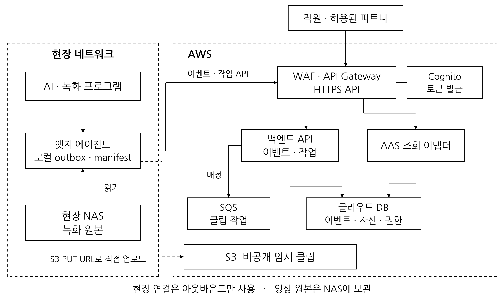
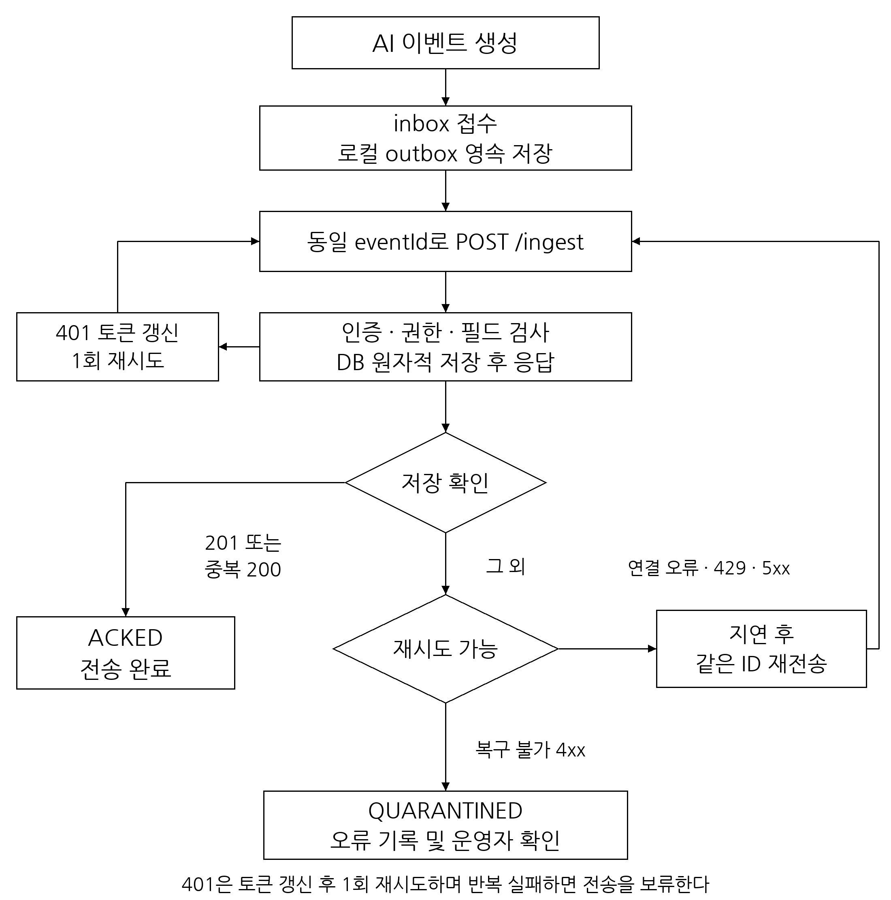
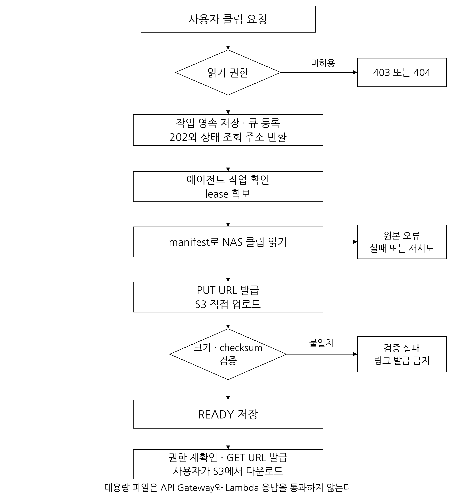
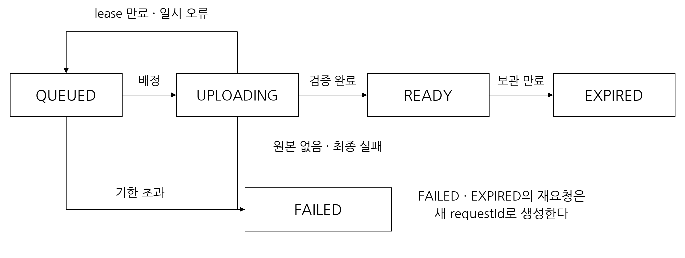

# 퓨처렉스 DSC AI CCTV 백엔드 및 엣지 에이전트 연동 규격서

문서번호 F2X DSC CCTV INT 001

버전 1.0　발행일 2026년 11월 7일　적용 대상 AWS 백엔드 및 현장 엣지 에이전트

## 1 서비스 개요

### 1 1 목적

본 규격은 DSC 센터에서 발생하는 CCTV 및 온도 센서 이벤트의 수집, 저장, 조회와 녹화 클립 전달을 정의한다. 백엔드는 센터별 이벤트 이력과 자산 정보를 관리하고, 엣지 에이전트는 현장 데이터를 영속 보관한 뒤 전송한다. 녹화 원본은 현장 NAS에 보관하며 조회에 필요한 클립만 AWS로 업로드한다.

### 1 2 적용 범위

| 구분 | 담당 기능 | 전달 산출물 |
|---|---|---|
| AWS 백엔드 | 인증과 권한 검사, 이벤트 수신 및 조회, AAS 조회, 영상 작업과 임시 링크 | API, 데이터 스키마, 배포 및 운영 설정 |
| 엣지 에이전트 | 로컬 접수, 미전송 데이터 보관, 재전송, 상태 보고, NAS 클립 업로드 | 설치 패키지, 서비스 등록, 로컬 접수 및 복구 기능 |
| AI 및 녹화 프로그램 | 이벤트 판정, 사건 식별, 녹화와 클립 생성 | 이벤트 JSON, 클립 식별자, 생성 완료 통지 |
| 현장 운영 | 장비와 위치 등록, NAS 접근, 네트워크와 원본 보관 | 센터 및 자산 등록 정보, NAS 읽기 계정 |
| 서비스 운영 | 사용자와 파트너 권한, 운영 설정, 장애 및 감사 관리 | 배포 매니페스트, 권한표, 백업 및 장애 대응 절차 |

실시간 영상 스트리밍, AMR 운행 제어, 배터리 자동 격리 명령, 화재 판정 모델 및 문자·메신저 알림 발송은 본 연동 범위에서 제외한다. 이벤트 저장 완료와 현장 안전 조치 완료는 별도 상태로 관리한다.

### 1 3 용어와 식별자

| 항목 | 정의 | 형식 |
|---|---|---|
| eventId | 개별 감지 기록. 재전송 중 변경하지 않음 | UUID |
| incidentId | 같은 사건의 발생과 해소를 연결하는 식별자 | UUID |
| siteId | 센터의 변경하지 않는 식별자 | 등록 문자열 |
| assetId | 카메라, 센서, 랙, 경로, AMR 및 배터리 식별자 | 등록 문자열 |
| agentId | 설치된 에이전트 식별자. 인증 정보로 결정 | 등록 문자열 |
| clipId | 기본 녹화 클립 식별자 | UUID |
| requestId | 클립 전달 작업 식별자 | UUID |
| traceId | 개별 API 호출 추적 식별자 | 서버 발급 문자열 |
| outbox | 서버 전송 전 데이터를 보관하는 현장 영속 큐 | 로컬 DB |
| lease | 특정 에이전트의 작업 처리 권한과 유효기간 | 서버 발급 토큰 |

센터명과 장비 표시명은 화면 표시용이다. 데이터 연결에는 siteId와 assetId를 사용한다. 모든 자산은 하나의 센터에 소속되고, 센터 간 자산 이동은 운영자가 등록 정보를 갱신한다.

## 2 시스템 구성

### 2 1 전체 아키텍처



현장 에이전트는 외부로 시작하는 HTTPS 연결만 사용한다. NAS 관리 포트, SMB 및 NFS를 인터넷에 공개하지 않는다. AWS 백엔드는 NAS를 직접 마운트하지 않는다. 에이전트는 작업 API를 통해 업로드 요청을 확인하고, 서버가 발급한 S3 PUT URL로 클립을 전송한다.

### 2 2 구성 요소

| 구성 요소 | 기능 | 접속 및 처리 원칙 |
|---|---|---|
| Route 53 및 ACM | 서비스 주소와 HTTPS 인증서 | 운영 API 도메인 dsc.f2x.ai |
| API Gateway REST API 및 WAF | 외부 요청 접수, 토큰과 scope 검사, 요청 제한 | 모든 보호 경로에 인증 적용 |
| Cognito User Pool | 직원 및 서버 인증 | 직원 로그인과 M2M app client 분리 |
| Lambda | 이벤트, 조회, AAS 및 파일 작업 API | 영상 바이트를 중계하지 않음 |
| 클라우드 DB | 이벤트, 자산, 권한 및 작업 상태 | 이벤트 중심 저장, 원자적 갱신과 중복 제약 적용 |
| SQS | 클립 업로드 작업 전달 | AWS 내부 사용. 센터별 배정 범위 검사 |
| S3 | 요청 클립의 임시 보관 | 비공개 버킷, 객체별 임시 URL |
| 현장 NAS | 녹화 원본 보관 | 허용 디렉터리 읽기 계정 사용 |
| 현장 에이전트 | 이벤트 전송과 클립 업로드 | outbox와 클립 manifest를 디스크에 보관 |

### 2 3 데이터 소유와 장애 경계

이벤트와 관련 자산의 연결은 클라우드 DB가 관리한다. AAS는 같은 DB를 조회해 응답을 조립하며 이벤트를 별도로 복제 저장하지 않는다. 클립 경로와 NAS 계정은 현장 에이전트에서만 관리한다.

NAS나 현장 인터넷이 중단돼도 클라우드에 저장된 이벤트와 자산 정보는 조회할 수 있다. 단절 중 새로 발생한 이벤트는 outbox에 보관하고 복구 후 전송한다. NAS에만 있는 클립은 현장 연결이 복구될 때까지 제공할 수 없다.

## 3 인증 및 접근 제어

### 3 1 인증 방식

직원은 회사 계정을 Cognito에 SAML 또는 OIDC로 연동해 로그인한다. 브라우저 및 모바일 클라이언트는 authorization code와 PKCE를 사용한다. 공개 클라이언트에는 client secret을 포함하지 않는다.

파트너 서버, 현장 에이전트 및 내부 배치 서버는 client_credentials로 access token을 발급받는다. 파트너 회사와 에이전트 설치 단위로 각각 app client를 등록한다. 직원 개인 식별에는 사용자 sub를, M2M 식별에는 client_id를 사용한다.

클라이언트는 Authorization: Bearer 헤더에 access token을 전달한다. API Gateway와 백엔드는 서명, iss, exp, token_use, 허용된 client_id 및 기능 scope를 검증한다. 서버의 주체 등록이 비활성 상태이면 만료 전 토큰도 거부한다.

### 3 2 기능 및 데이터 권한

| API 기능 | 필요한 scope | 추가 검사 |
|---|---|---|
| AAS 기본 조회 | dsc/aas.read | 허용된 센터와 자산, 공개 Submodel 종류 |
| 이벤트 및 TimeSeries 조회 | dsc/timeseries.read | 허용된 센터와 자산. AAS 경로는 aas.read도 필요 |
| 클립 요청 및 링크 발급 | dsc/timeseries.read | 이벤트와 클립에 대한 읽기 권한 |
| 이벤트 및 녹화 상태 전송 | dsc/ingest.write | 등록 에이전트의 센터와 발신 자산 |
| 작업 조회 및 상태 보고 | dsc/agent.work | 등록 에이전트에 배정된 작업 |

기능 scope와 데이터 허용 범위를 모두 충족해야 접근할 수 있다. scope만으로 센터 전체 접근을 허용하지 않는다. 요청 본문과 헤더의 siteId는 서버 등록 정보와 비교하며 권한의 근거로 사용하지 않는다. 복수 scope를 모두 요구하는 조건은 백엔드에서 직접 확인한다.

파트너는 기본적으로 허용 자산의 Nameplate와 공개된 TechnicalData만 조회할 수 있다. 이벤트 이력과 영상은 명시적으로 등록한 권한이 있을 때 제공한다. 직원에게도 담당 센터 범위를 적용한다.

이벤트 전체를 조회하려면 해당 센터 전체의 읽기 권한 또는 이벤트에 연결된 모든 자산의 읽기 권한이 있어야 한다. 관련 자산 일부만 허용된 경우 이벤트 본문과 연결 자산 목록을 반환하지 않는다. 클립에도 같은 판정 기준을 적용한다.

권한 없는 단건 자산, 이벤트 또는 영상 작업은 404를 반환한다. 목록과 집계는 권한 필터를 적용한 후 페이지와 개수를 계산한다. 기능 scope 부족은 403이다. AAS의 Shell 본문, 참조 목록, Registry, 단건 Submodel 및 $value에 동일 정책을 적용한다. 등록하지 않은 Submodel 종류는 거부한다.

### 3 3 비밀과 저장소 보호

에이전트는 SQS용 AWS access key를 보유하지 않는다. 작업은 자체 HTTPS API로 확인하며 S3 업로드는 객체 한 개에 한정한 PUT URL을 사용한다. AWS 서비스 간 접근은 Lambda 실행 역할의 최소 권한으로 제한한다.

client secret과 NAS 비밀번호는 설치 OS의 보안 저장소 또는 읽기 권한을 제한한 비밀 저장소에 보관한다. 소스, 배포 저장소 및 로그에 기록하지 않는다. 장비 분실과 교체 시 에이전트를 비활성화하고 시크릿을 교체한다. NAS 계정에는 녹화 디렉터리 읽기 권한만 부여한다.

## 4 공통 통신 규격

### 4 1 전송 형식

| 항목 | 규격 |
|---|---|
| Base URL | https://dsc.f2x.ai |
| 프로토콜 | HTTPS |
| 본문 | UTF-8 JSON, Content-Type: application/json |
| 데이터 버전 | schemaVersion: 1.0 |
| 시각 | UTC RFC 3339, Z 표기, 밀리초 정밀도 |
| 기간 필터 | from 이상 to 미만 |
| 수치 | 필드명과 사전에 명시한 단위 |
| 요청 추적 | 응답 X-Request-Id와 오류 본문 traceId |
| 클립 응답 캐시 | Cache-Control: no-store |

선택 값이 없으면 필드를 생략한다. 측정 실패를 null, 빈 문자열 또는 0으로 대체하지 않는다. 유효한 실측값 0은 허용한다. NaN, Infinity, 음수 길이 및 정의하지 않은 최상위 필드는 거부한다. 지원하지 않는 schemaVersion은 422를 반환한다.

AAS ID와 Submodel ID는 등록된 URI를 사용한다. URL 경로의 식별자는 UTF-8 base64url로 인코딩하고 padding을 생략한다. AAS 경로의 페이지 및 오류 형식은 AAS API v3.1.2 스키마를 따른다.

### 4 2 응답 상태

| HTTP 상태 | 의미 | 클라이언트 처리 |
|---|---|---|
| 200 | 조회, 갱신 또는 동일 데이터 재수신 확인 | 응답 본문의 상태 확인 |
| 201 | 신규 이벤트의 영속 저장 완료 | outbox를 ACKED로 전환 |
| 202 | 영상 작업 접수 또는 처리 중 | Location 및 Retry-After에 따라 조회 |
| 204 | 배정할 작업 없음 | 작업 확인 주기 후 재조회 |
| 400 | 잘못된 JSON 또는 요청 형식 | 입력 수정 |
| 401 | 토큰 오류 | 갱신 후 한 번 재시도 |
| 403 | 기능 권한 부족 | 자동 반복 중단 |
| 404 | 리소스 없음 또는 미공개 | 자동 반복 중단 |
| 409 | 이벤트 ID, revision 또는 lease 충돌 | 현재 데이터와 작업 상태 확인 |
| 413 및 422 | 크기 초과 또는 필드 검증 실패 | 격리 후 원인 수정 |
| 429 및 5xx | 요청 제한 또는 일시 장애 | 지연 후 재시도 |

자체 API 오류는 error.code, error.message, error.traceId, error.retryable을 반환한다. API Gateway 및 S3가 직접 반환한 오류는 서비스 고유 형식일 수 있으므로 HTTP 상태를 함께 검사한다.

```json
{
  "error": {
    "code": "EVENT_ID_CONFLICT",
    "message": "동일 eventId에 다른 이벤트가 저장되어 있습니다",
    "traceId": "api-call-id",
    "retryable": false
  }
}
```

## 5 이벤트 수신 및 저장

### 5 1 이벤트 전송 흐름



POST /ingest는 이벤트 한 건을 수신한다. dsc/ingest.write 및 에이전트의 센터 권한을 검사한 뒤 이벤트 본문, 자산 연결과 초기 클립 정보를 하나의 영속화 단위로 저장한다. 저장 완료 후에만 201을 반환한다.

### 5 2 요청 필드

| 필드 | 타입 | 필수 | 규칙 |
|---|---|---|---|
| schemaVersion | string | 예 | 1.0 |
| eventId | UUID string | 예 | 재전송 중 동일 값 유지 |
| eventCode | string | 예 | 5 4의 이벤트 코드 |
| siteId | string | 예 | 인증된 에이전트의 센터와 일치 |
| occurredAt | date-time | 예 | 실제 감지 시각 |
| incidentId | UUID string | 조건부 | 발생 및 해소 쌍을 연결 |
| assets | object array | 예 | 등록 자산 최소 한 개 |
| assets[].assetId | string | 예 | 해당 센터에 소속된 자산 |
| assets[].role | enum | 예 | detector, subject, context |
| metrics | object | 아니오 | 코드별 수치 사전 적용 |
| confidence | number | 아니오 | 0 이상 1 이하의 모델 신뢰도 |
| modelVersion | string | 아니오 | 감지 모델 버전 |
| media | object | 아니오 | 기본 클립 정보 |
| media.clipId | UUID string | 조건부 | media가 있으면 필수 |
| media.status | enum | 조건부 | RECORDING, AVAILABLE, MISSING, NOT_APPLICABLE |

agentId는 인증 정보에서 결정하고 receivedAt과 payloadHash는 서버가 생성한다. 초기 media의 revision은 서버가 0으로 설정하며, 상태별 추가 필드 조건은 6 3을 따른다. 자산은 서버 등록 정보로 검증한다. 동일 자산의 같은 role이 중복되면 한 번만 연결한다. 존재하지 않는 자산, 다른 센터의 자산 또는 잘못된 필수 필드는 저장하지 않는다.

```json
{
  "schemaVersion": "1.0",
  "eventId": "8a394e71-50ac-4cde-b691-48c171f3a062",
  "eventCode": "DSC-102A",
  "siteId": "incheon-01",
  "occurredAt": "2026-11-07T06:00:00.000Z",
  "incidentId": "a1ea9c1f-2c69-4e52-aabe-d7414986e31a",
  "assets": [
    {"assetId": "cctv-r01", "role": "detector"},
    {"assetId": "amr-01", "role": "subject"},
    {"assetId": "path-01", "role": "context"}
  ],
  "metrics": {"estimatedClearanceMarginM": 0.5},
  "media": {
    "clipId": "94028d0a-4ef7-4fd4-9695-d195a78b40ce",
    "status": "RECORDING"
  }
}
```

### 5 3 중복과 응답

동일 eventId와 동일한 최초 요청 본문을 다시 수신하면 기존 저장 결과를 200으로 반환하고 duplicate를 true로 설정한다. 동일 eventId의 본문이 다르면 409 EVENT_ID_CONFLICT로 거부한다. JSON 키 순서와 공백은 비교에서 정규화한다. 서버 생성 필드와 이후 별도 API에서 갱신한 클립 상태는 최초 요청 본문을 변경하지 않는다.

201 및 중복 수신 200 응답은 eventId, agentId, siteId, receivedAt, duplicate를 포함한다. receivedAt은 최초 저장 시각이다. DB 저장 중 일부만 성공하거나 영속화를 확인할 수 없으면 성공 응답을 반환하지 않는다. 성공 응답이 유실된 경우에도 같은 eventId로 안전하게 재전송할 수 있어야 한다.

### 5 4 이벤트 코드와 수치

| 코드 | 의미 | 사건 연결 |
|---|---|---|
| DSC-101 | 카메라 연결 오류 | 단건 |
| DSC-102A 및 DSC-102B | 통로 물체 감지 및 제거 | 같은 incidentId |
| DSC-103A 및 DSC-103B 및 DSC-103C | 배터리 입고 및 이동 및 출고 | 각각 개별 기록 |
| DSC-104A 및 DSC-104B | 랙 이물질 감지 및 제거 | 같은 incidentId |
| DSC-105 | 배터리 운송 중 낙하 | 단건 |
| DSC-106A 및 DSC-106B | AMR 이동 중 정지 및 재개 | 같은 incidentId |
| DSC-201 | 온도 센서 연결 오류 | 단건 |
| DSC-202A 및 DSC-202B | 화재 감시 중 온도 이상 및 정상화 | 같은 incidentId |
| DSC-203 | 온도 센서 비정상 데이터 | 단건 |
| DSC-301 | 영상 분석 파이프라인 오류 | 단건 |
| DSC-302 | 정상 배경 갱신 필요 | 단건 |
| DSC-303 | 영상 저장 오류 | 단건 |

발생과 해소는 서로 다른 eventId를 사용한다. 사건이 재발하면 새로운 incidentId를 발급한다. 진행 중 사건은 에이전트 재시작 후 복원한다. 순서가 뒤바뀌거나 발생 기록 없이 해소 기록이 먼저 도착해도 원본 이벤트는 보관한다. 수신 순서만으로 정상화 여부를 결정하지 않는다.

| metrics 필드 | 단위 및 검증 | 적용 코드 |
|---|---|---|
| pingLatencyMs | ms, 0 이상 | DSC-101 |
| packetLossRatePct | %, 0~100 | DSC-101 |
| estimatedClearanceMarginM | m, 0 이상 | DSC-102A 및 DSC-102B |
| delaySec | 초, 0 이상 | 지연을 측정한 이벤트 |
| estimatedDropHeightM | m, 0 이상 | DSC-105 |
| readFailureCount | 횟수, 0 이상 정수 | DSC-201 |
| fireAnomalyScore | 모델의 등록 점수 범위 | DSC-202A |
| noiseVariance | 센서의 등록 윈도와 단위 | DSC-203 |

측정할 수 없는 수치는 생략한다. 모델 버전별 점수 범위와 센서 단위는 자산 메타데이터에 등록한다. 온도 이상 기록만으로 서버가 화재를 확정하지 않는다. 배터리 ID를 식별할 수 없는 경우 랙과 위치에 귀속하며 개별 배터리 상태나 SOH를 임의로 생성하지 않는다.

## 6 현장 에이전트

### 6 1 로컬 접수 인터페이스

AI 및 녹화 프로그램은 공유된 로컬 inbox 디렉터리에 JSON 파일을 전달한다. 작성 중 파일의 확장자는 .tmp로 두고, 쓰기와 파일 동기화를 마친 뒤 같은 파일시스템에서 .json으로 원자적 이름 변경을 수행한다. 에이전트는 .json 파일만 읽는다. 디렉터리는 해당 서비스 계정에만 쓰기를 허용한다.

| 파일 종류 | 파일명 | 본문 |
|---|---|---|
| 신규 이벤트 | {eventId}.event.json | kind=event, event, 선택 localMedia |
| 클립 상태 변경 | {eventId}.{revision}.media.json | kind=media, eventId, media, 선택 localMedia |

event는 5장의 POST /ingest 본문과 동일하다. media는 6 3의 상태 갱신 본문이다. localMedia는 clipId와 NAS 루트 기준 relativePath를 포함한다. localMedia는 로컬 manifest에만 저장하며 클라우드 전송 본문에서 제거한다.

에이전트는 이벤트와 클립 매핑을 로컬 DB 트랜잭션에 저장한 후 입력 파일을 accepted 디렉터리로 이동한다. 잘못된 파일은 rejected로 이동하고 사유를 별도 JSON에 기록한다. DB 저장 후 파일 이동 전에 종료돼도 재접수 시 중복 저장하지 않는다. accepted 파일 정리는 서버 전송 완료 여부와 별도로 수행하며 outbox가 전송의 기준이다.

클립 경로는 realpath로 정규화해 허용 NAS 루트 안에 있는지 확인한다. 상위 경로 이동, 심볼릭 링크 우회 및 manifest 밖의 파일 접근은 거부한다. 클라우드 작업은 eventId와 clipId만 지정한다.

### 6 2 outbox와 재전송

| 상태 | 의미 | 전이 조건 |
|---|---|---|
| PENDING | 디스크 접수 완료, 전송 대기 | 전송 시작 시 SENDING |
| SENDING | 서버 응답 대기 | 201 또는 확인된 중복 200이면 ACKED |
| ACKED | 서버 영속 저장 확인 | 운영 보관 정책에 따라 로컬 정리 |
| QUARANTINED | 자동 전송으로 해소할 수 없는 오류 | 운영자 원인 수정 후 명시적 재처리 |

프로세스 재시작 시 남아 있는 SENDING은 PENDING으로 복구한다. ACKED 전까지 eventId와 최초 전송 본문을 유지한다. 클립 상태 변경은 이벤트 저장 ACK 후 전송하며, 갱신 revision별 응답을 따로 확인한다.

네트워크 오류, 응답 불명, 429와 5xx는 재시도한다. 지연은 1초에서 배수로 증가시키고 최대 60초로 제한한 후 임의 지연을 적용한다. Retry-After가 있으면 우선한다. 401은 토큰 갱신 후 한 번 재시도하고 지속되면 전송을 보류한다. 400, 403, 404, 409, 413, 422는 격리하고 자동 반복하지 않는다.

미전송 이벤트를 용량 확보 목적으로 자동 삭제하지 않는다. 디스크 쓰기 실패는 로컬 접수 실패로 처리하고 운영 경고를 남긴다. 시크릿, 토큰과 서명 URL은 outbox 진단 로그에 포함하지 않는다.

### 6 3 클립 상태 갱신

PUT /ingest/events/{eventId}/media는 원본 이벤트를 보낸 에이전트만 호출한다. 본문은 clipId, revision, status와 선택 startedAt, endedAt, contentType, sizeBytes를 포함한다. revision은 1부터 증가하고 로컬에 영속 보관한다.

| status | 의미 | 필드 조건 |
|---|---|---|
| RECORDING | 녹화 또는 클립 생성 중 | clipId와 revision 필수 |
| AVAILABLE | 쓰기 완료 후 읽을 수 있음 | startedAt, endedAt, video/mp4, 양의 sizeBytes 필수 |
| MISSING | 삭제 또는 접근 확인 결과 원본 없음 | 기존 clipId 유지 |
| NOT_APPLICABLE | 해당 이벤트에 클립을 제공하지 않음 | 다운로드 작업 생성 불가 |

같은 revision과 같은 본문은 200이다. 같은 revision의 다른 본문과 오래된 revision은 409이다. 최초 clipId를 다른 값으로 교체할 수 없다. 최초 이벤트에 media가 없었다면 첫 갱신에서 한 번 등록할 수 있다. 이벤트 본문과 클립 상태는 별도 레코드로 관리한다.

### 6 4 상태 보고와 실행

POST /agent/heartbeat는 schemaVersion, agentVersion, observedAt, outboxPendingCount, diskFreeBytes, nasStatus와 선택 oldestPendingAt를 전송한다. 개수와 용량은 0 이상 정수이다. nasStatus는 OK, UNREACHABLE, READ_ERROR이다. 대기 건이 있을 때 oldestPendingAt를 포함한다. 서버는 200과 agentId, serverTime을 반환한다.

기본 보고 주기는 60초이다. 마지막 수신 후 5분이 지나면 OFFLINE으로 표시한다. OFFLINE은 통신 미확인 상태이며 장비 고장을 확정하는 값이 아니다. heartbeat 실패는 이벤트 전송을 막지 않는다.

에이전트는 OS 서비스로 자동 시작하고 비정상 종료 시 재시작한다. 업데이트와 롤백은 outbox, 진행 중 incidentId, 클립 manifest를 보존한다. 시스템 시각을 동기화하고 토큰은 만료 전에 갱신한다.

## 7 이벤트 조회 및 AAS

### 7 1 이벤트 조회 API

| API | 응답 | 권한 |
|---|---|---|
| GET /events | items, nextCursor | timeseries.read 및 센터·자산 범위 |
| GET /events/{eventId} | 이벤트, 자산 연결, 현재 클립 상태 | 해당 이벤트 읽기 |
| GET /timeseries/{assetId}/current | 자산별 당일 통계 | 해당 자산의 이력 읽기 |
| GET /timeseries/{assetId}/archive | 자산별 이벤트 items, nextCursor | 해당 자산의 이력 읽기 |

/events는 siteId, assetId, eventCode, from, to, cursor, limit를 지원한다. from과 to 및 siteId 또는 assetId 중 하나를 필수로 지정한다. archive는 경로의 assetId와 from, to를 사용한다. 필터를 함께 지정하면 모두 만족하는 이벤트만 조회한다.

정렬은 occurredAt 내림차순, eventId 내림차순이다. 하나의 이벤트가 여러 자산에 연결돼도 같은 검색 결과에는 한 번만 반환한다. 페이지 기본값은 100, 최대 500이며 조회 기간은 최대 31일이다. cursor는 필터, 정렬 및 요청자의 권한 범위와 결합해 검증한다. 다음 페이지가 없으면 nextCursor를 생략한다. 목록은 조회 시점의 저장 결과를 제공하며 지연 수신 이벤트가 뒤에 추가될 수 있다.

current는 UTC 당일 00시부터 asOf까지의 occurredAt를 집계한다. 응답은 assetId, recordCount, asOf와 선택 startTime, endTime이다. startTime과 endTime은 실제 이벤트의 최소·최대 발생 시각이며 결과가 없으면 생략한다. archive는 현재 날짜를 포함한 전체 저장 이력을 기간별로 조회한다.

### 7 2 AAS 조회 계약

AAS 어댑터는 IDTA HTTP/REST API v3.1.2의 식별자 및 직렬화 규칙을 적용한다. 쓰기 API는 제공하지 않는다. Shell, Submodel과 Registry 응답은 등록 자산 메타데이터와 이벤트 조회 결과로 조립한다.

| API | 제공 내용 |
|---|---|
| GET /lookup/shells | assetIds를 통한 AAS ID 검색 |
| GET /shell-descriptors 및 /shell-descriptors/{aasId} | 자산 Shell의 접속 정보 |
| GET /shells/{aasId} | 자산 식별과 허용 Submodel 참조 |
| GET /shells/{aasId}/submodel-refs | 허용 Submodel 목록 |
| GET /submodel-descriptors/{submodelId} | Submodel 접속 정보 |
| GET /submodels/{submodelId} 및 /$value | Submodel 원문 및 값 표현 |
| GET /description | 구현 버전과 실제 지원 프로파일 |

등록 자산은 globalAssetId, aasId, idShort와 제공 Submodel별 ID 및 semanticId를 가진다. Nameplate는 제조사, 제품명과 일련번호 등 자산 식별 정보를 제공하고 TechnicalData는 등록된 사양과 단위를 제공한다. TimeSeries는 이력 조회를 위한 통계와 인증된 /timeseries Endpoint를 제공한다. 알 수 없는 제조사나 장비 수치를 생성하지 않는다.

Submodel 템플릿은 배포 산출물에 버전이 고정된 파일로 포함하고 자산 메타데이터 필드와의 매핑을 관리한다. 응답은 해당 스키마로 검증한다. /description에는 실제로 충족한 프로파일만 표시한다. 하위 요소 idShortPath는 배포한 Submodel 필드 경로에 한정한다.

AAS Endpoint에 NAS 경로나 S3 서명 URL을 저장하지 않는다. 이력과 클립에 접근할 때 자체 API에서 인증과 권한을 다시 확인한다. 권한 없는 TimeSeries는 Shell 참조와 Registry에서도 제외한다.

## 8 녹화 클립 전달

### 8 1 요청 및 처리 흐름



클립 전달은 작업 접수, 현장 업로드, 서버 검증, 임시 링크 발급으로 처리한다. 기본 제공 단위는 이벤트당 기본 클립 한 개이며 원본 녹화 전체와 임의 시간 범위 편집은 제공하지 않는다.

### 8 2 요청 API

POST /files/{eventId}/requests는 빈 JSON 객체로 기본 클립 전달을 요청한다. 동일 eventId와 clipId의 활성 작업은 재사용한다. 유효한 READY 객체가 있으면 기존 작업과 링크를 200으로 반환한다. 새 작업은 DB에 영속 저장한 뒤 202를 반환한다.

RECORDING은 409 CLIP_NOT_READY, MISSING 및 NOT_APPLICABLE은 404 CLIP_UNAVAILABLE을 반환한다. 사용자의 반복 요청이나 네트워크 재시도가 동시에 여러 업로드를 생성하지 않도록 한다.

GET /file-requests/{requestId}는 작업 상태를 조회한다. GET /files/{eventId}는 최신 기본 클립 작업을 조회한다. 조회만으로 작업을 만들지 않으며 작업이 없으면 404 FILE_REQUEST_NOT_FOUND이다. QUEUED와 UPLOADING은 202, READY, FAILED, EXPIRED는 200으로 상태를 반환한다.

```json
{
  "requestId": "fa19c81b-6590-4c74-89d7-9938b52b0817",
  "eventId": "8a394e71-50ac-4cde-b691-48c171f3a062",
  "clipId": "94028d0a-4ef7-4fd4-9695-d195a78b40ce",
  "status": "QUEUED",
  "retryAfterSec": 5,
  "statusUrl": "/file-requests/fa19c81b-6590-4c74-89d7-9938b52b0817"
}
```

202에는 Location과 Retry-After를 제공한다. READY 응답에는 downloadUrl, urlExpiresAt, objectExpiresAt, sizeBytes, contentType을 포함한다. 다른 상태에는 downloadUrl을 포함하지 않는다. FAILED는 failureCode와 retryable을 반환한다. 작업 생성, 상태 조회 및 URL 재발급 때마다 현재 데이터 권한을 검사한다.

### 8 3 작업 상태



| 상태 | 정의 | 전이 |
|---|---|---|
| QUEUED | DB 접수 후 배정 대기 | lease 확보 시 UPLOADING |
| UPLOADING | 한 에이전트가 처리 권한 확보 | 검증 완료 시 READY, 재시도 시 QUEUED |
| READY | 객체 존재, 크기와 checksum 검증 완료 | 보관 기간 종료 시 EXPIRED |
| FAILED | 최종 실패 또는 처리 기한 초과 | 새 요청은 새 requestId로 생성 |
| EXPIRED | 임시 보관 기간 종료 | 원본이 있으면 새 요청 생성 가능 |

작업은 접수 후 30분 안에서 최대 3회 시도한다. 각 시도마다 새로운 lease와 업로드 객체 키를 발급한다. 만료되거나 대체된 시도의 complete 및 fail은 작업 상태를 변경할 수 없다. 동일 시도의 완료 재통지는 이미 READY이면 200으로 응답한다.

SQS 메시지에는 requestId와 최소 배정 정보를 기록한다. DB 상태가 처리의 기준이며, 큐 메시지 중복 전달에도 유효 lease 하나만 획득하도록 조건부 갱신한다. DB 접수 후 큐 전달 전 장애는 미전달 표식과 재발행으로 복구한다. 성공 또는 최종 실패 상태 저장 후 메시지를 삭제한다. 수신 핸들과 visibility 연장은 백엔드가 관리한다.

### 8 4 에이전트 작업 API

| API | 요청 본문 | 성공 결과 |
|---|---|---|
| POST /agent/jobs/claim | 빈 JSON 객체 | 200과 작업 및 lease. 작업 없으면 204 |
| POST /agent/jobs/{requestId}/lease | leaseToken | 200과 leaseExpiresAt |
| POST /agent/jobs/{requestId}/upload-url | leaseToken, sizeBytes, checksumSha256, contentType | 200과 uploadUrl, urlExpiresAt, headers |
| POST /agent/jobs/{requestId}/complete | leaseToken | 검증 후 200과 status |
| POST /agent/jobs/{requestId}/fail | leaseToken, failureCode, retryable | 200과 서버 결정 status |

claim 응답은 requestId, eventId, clipId, attempt, leaseToken, leaseExpiresAt를 포함한다. agentId, 센터, 원본 클립 소유 관계와 요청 주체의 활성 상태를 검사한다. lease는 기본 5분이며 60초마다 연장한다. 토큰은 에이전트, 작업, 시도 번호와 만료에 결합한다. 다른 에이전트의 토큰과 오래된 lease는 409로 거부한다.

sizeBytes는 양의 정수, checksumSha256은 전체 파일 SHA-256의 base64 값, contentType은 video/mp4이다. 단일 클립 크기는 최대 512 MiB이다. 서버가 객체 키와 업로드 조건을 결정한다. 에이전트가 임의 버킷이나 객체 키를 지정할 수 없다.

PUT URL은 시도별 객체 키, Content-Type과 x-amz-checksum-sha256을 서명에 결합한다. 에이전트는 headers에 지정된 값을 그대로 전송한다. complete는 S3 객체의 실제 크기와 checksum을 등록값과 대조한 후 READY로 전환한다. ETag를 SHA-256으로 사용하지 않는다. 같은 lease의 완료 재통지는 중복 처리하지 않는다.

| 실패 코드 | 의미 | 처리 |
|---|---|---|
| SOURCE_NOT_FOUND | manifest 또는 원본 파일 없음 | FAILED 및 클립 상태 재확인 |
| SOURCE_UNREACHABLE | NAS 일시 접근 실패 | 남은 기한과 횟수 안에서 재시도 |
| UPLOAD_FAILED | S3 전송 오류 | 새 시도로 재시도 |
| UPLOAD_VERIFICATION_FAILED | 서버 크기 또는 checksum 불일치 | 링크 발급 금지, 새 시도 또는 FAILED |
| JOB_TIMEOUT | 작업 기한 초과 | FAILED |
| LEASE_EXPIRED 및 LEASE_CONFLICT | 만료 또는 대체된 작업 권한 | 이전 시도 처리 중단 |

### 8 5 임시 저장 및 다운로드

클립 버킷은 Block Public Access, ACL 비활성화, HTTPS 강제 및 SSE-S3 암호화를 적용한다. 시도별 고유 객체 키를 사용하고 versioning은 비활성화한다. 업로드 URL은 15분, 다운로드 URL은 5분, READY 클립의 임시 보관은 24시간이다. 다운로드 URL의 만료는 objectExpiresAt를 넘기지 않는다.

임시 URL은 이를 보유한 사람이 유효기간 안에 반복 사용할 수 있다. 계정 권한 회수만으로 이미 발급한 S3 URL의 즉시 무효화를 보장하지 않는다. URL 전체를 로그에 기록하지 않고 링크 발급과 실제 S3 접근 기록을 구분한다.

objectExpiresAt가 지나면 새 링크를 발급하지 않고 EXPIRED로 표시한다. 정리 작업은 만료 객체와 중단된 시도 객체를 삭제하고 실패를 기록한다. Lifecycle은 누락 객체를 정리하는 보조 규칙으로 사용한다. 물리 삭제 완료와 서비스 접근 만료는 별도 시각으로 관리한다.

## 9 데이터 구조와 무결성

### 9 1 논리 저장 구조

| 데이터 | 주요 필드 | 키 및 제약 |
|---|---|---|
| events | eventId, agentId, siteId, eventCode, occurredAt, receivedAt, incidentId, payload, payloadHash | eventId 유일. 최초 본문 불변 |
| event_assets | eventId, assetId, role | 조합 유일. 이벤트와 자산 존재 검사 |
| assets | assetId, siteId, assetType, displayName, AAS 메타데이터 | assetId 유일. 센터 소속 검증 |
| event_media | eventId, clipId, revision, status, 시간, 크기 | 이벤트당 기본 클립 한 개. revision 증가 |
| principals 및 grants | 주체 키, 활성 상태, scope, 센터와 자산 허용 범위 | 사용자와 M2M 주체 구분 |
| agents | agentId, client_id, siteId, 활성 상태, 마지막 상태 보고 | client_id와 agentId 매핑 유일 |
| file_requests | requestId, eventId, clipId, 상태, 시도 번호, 기한, 객체 정보 | 같은 클립의 활성 작업 중복 제한 |
| job_leases | requestId, attempt, agentId, tokenHash, leaseExpiresAt | 작업당 유효 lease 한 개 |
| local outbox | eventId, 최초 본문, 전송 상태, 재시도 정보 | 로컬 트랜잭션과 재시작 복구 |
| local manifest | clipId, 상대 경로, revision, 상태 | NAS 허용 루트 내부 파일만 |

### 9 2 저장 제약

events와 event_assets 및 초기 event_media는 한 번에 저장하거나 전체 실패로 처리한다. 사건과 수신 시각은 별도로 보관하고 지연 수신으로 occurredAt을 바꾸지 않는다. 권한이 없는 센터로 기록을 이동하는 갱신은 허용하지 않는다.

조회 인덱스는 센터별 occurredAt와 eventId, 자산별 eventId, incidentId와 eventCode, 영상 작업 상태와 기한을 지원해야 한다. DB 제품과 물리 배치는 배포 매니페스트에 기록하고 이 논리 제약과 API 결과를 동일하게 유지한다.

## 10 운영 설정과 장애 처리

### 10 1 기본 동작 설정

| 설정 | 기본값 | 적용 |
|---|---|---|
| 이벤트 본문 상한 | 256 KiB | 단건 JSON |
| 목록 크기 | 기본 100, 최대 500 | 이벤트 조회 |
| 조회 기간 상한 | 31일 | from 및 to |
| 이벤트 재시도 | 1초 시작, 최대 60초 | 임의 지연 적용 |
| heartbeat 및 OFFLINE | 60초 및 5분 | 통신 상태 |
| 작업 확인 주기 | 5초 | claim 호출 |
| 작업 lease 및 연장 주기 | 5분 및 60초 | 진행 중 업로드 |
| 작업 기한 및 최대 시도 | 30분 및 3회 | requestId 단위 |
| PUT 및 GET URL | 15분 및 5분 | 임시 S3 접근 |
| 임시 클립 보관 | READY 후 24시간 | 서비스 접근 만료 |
| 단일 클립 상한 | 512 MiB | video/mp4 |

### 10 2 배포 매니페스트

운영 배포 시 아래 값을 환경별 매니페스트에 기록한다. 비밀의 실제 값은 별도 저장소에 두고 매니페스트에는 참조만 기록한다. 운영 및 시험 환경의 계정, DB와 버킷을 분리한다.

| 구분 | 필수 설정 |
|---|---|
| AWS 및 인증 | 리전, API 주소, Cognito issuer와 token endpoint, app client, 비밀 참조 |
| 저장소 | DB 연결 및 암호화 설정, SQS 큐, S3 버킷, 정리 주기 |
| 현장 | agentId, siteId, 허용 자산, NAS 루트, 읽기 계정 참조, inbox와 outbox 경로 |
| 권한 | 직원 및 파트너 허용 센터·자산·Submodel과 영상 읽기 권한 |
| 보관 정책 | NAS 원본, 이벤트, 감사 로그, ACKED 데이터와 accepted 파일의 기간 |
| 감지 연동 | 모델 버전, 점수 범위와 단위, 클립 생성 규칙 |
| 운영 책임 | 장애 수신자, 백업 위치, 복구 절차, 용량 및 부하 시험 기준 |

미전송 outbox와 처리 중 파일은 일반 정리 작업의 삭제 대상에서 제외한다. 권한 설정이 없는 파트너는 기본 공개 범위만 허용한다. 운영 배포는 필수 환경값의 유효성 및 저장소 접근 시험을 통과한 뒤 시작한다.

### 10 3 관찰과 감사

API 로그는 traceId, 주체 ID, siteId, eventId 또는 영상 requestId, 처리 결과와 지연을 포함한다. 원본 데이터 접근과 권한 변경은 주체 및 시각을 감사 기록에 남긴다. access token, client secret, 서명 URL 쿼리와 NAS 비밀은 마스킹한다.

CloudWatch에서 API 오류, 최근 이벤트 수신 시각, 마지막 heartbeat, outbox 대기 건수와 최장 대기 시간, 영상 작업 대기 및 실패, 임시 객체 정리 실패를 관찰한다. S3 접근 감사는 데이터 이벤트와 접근 로그를 사용하고 로그 저장소를 암호화한다. 경보 수신과 확인 책임은 운영 매니페스트에 지정한다.

### 10 4 장애 대응

| 장애 | 서비스 동작 | 운영 조치 |
|---|---|---|
| 현장 인터넷 단절 | 로컬 접수 및 outbox 보관 지속 | 회선 복구와 대기 건 감소 확인 |
| 에이전트 종료 | 서비스 재시작과 미확인 전송 복원 | 재시작 이력 및 로컬 DB 점검 |
| NAS 접근 실패 | 메타데이터 조회 유지, 클립 작업 재시도 | 읽기 계정과 연결, 원본 존재 확인 |
| DB 저장 실패 | 성공 응답 금지, 에이전트 재시도 | 복구 후 중복 및 미전달 작업 점검 |
| 인증 반복 실패 | 전송 보류, 상태 및 로그 기록 | client 등록과 비밀, 시각 동기화 확인 |
| 디스크 부족 | 새 로컬 접수 실패와 경고 | 용량 확보. 미전송 데이터 임의 삭제 금지 |
| 업로드 검증 실패 | READY 및 링크 발급 금지 | 크기와 checksum, 시도 번호 확인 |

백업과 복구 시험은 DB, 권한 정보 및 현장 outbox를 대상으로 한다. 서비스 복구 후 이벤트 ID 중복, 자산 연결, 작업 상태와 원본 클립 접근을 확인한다. 복구 소요 시간과 복구 시점을 결과 기록에 남긴다.

## 11 검수 기준

| ID | 시험 항목 | 합격 기준 |
|---|---|---|
| AT01 | 정상 이벤트 수신 | 201 후 재조회 가능. 자산과 시각 일치 |
| AT02 | 응답 유실 후 재전송 | 200 duplicate. 이벤트와 연결 중복 없음 |
| AT03 | 동일 ID의 다른 본문 | 409. 기존 감지 본문 변경 없음 |
| AT04 | 인터넷 단절과 에이전트 재시작 | outbox 복원 및 동일 ID 전송 |
| AT05 | 다른 센터 자산과 위조 siteId | 저장 및 조회 거부 |
| AT06 | 직원 및 파트너 권한 | 목록, 집계, 단건, AAS와 파일 작업에 같은 정책 |
| AT07 | 주체 비활성화와 만료 토큰 | 접근 거부. 비밀 로그 없음 |
| AT08 | 발생과 해소 순서 역전 | 원본 보관 및 incidentId 연결 |
| AT09 | 녹화 중 또는 원본 누락 | 지정 오류 반환. 성공 링크 없음 |
| AT10 | 반복 클립 요청과 중복 큐 | 중복 활성 작업 없음. lease 한 개만 유효 |
| AT11 | 업로드 중단과 lease 만료 | 재배정 가능. 오래된 완료 통지 거부 |
| AT12 | 허위 완료와 checksum 불일치 | READY 및 링크 발급 거부 |
| AT13 | URL 및 객체 접근 만료 | 신규 링크 중단, 만료 및 정리 기록 확인 |
| AT14 | AAS 직렬화 | 고정 스키마와 소비자 연동 시험 통과 |
| AT15 | DB 장애와 큐 전달 중단 | 저장 미완료 성공 응답 없음. 미전달 작업 복구 |
| AT16 | 로컬 inbox 중복과 불완전 파일 | .tmp 무시. DB 접수 후 중복 처리 방지 |
| AT17 | 용량 및 복구 시험 | 운영 매니페스트 조건과 측정 결과 일치 |

개발 산출물에는 백엔드 소스와 배포 설정, 자체 API OpenAPI, DB 스키마와 마이그레이션, AAS 스키마 및 필드 매핑, 에이전트 설치 및 롤백 절차, 운영 매니페스트, 장애 복구 안내, 검수 결과를 포함한다. 비밀은 인수인계 문서와 소스에 포함하지 않는다.
