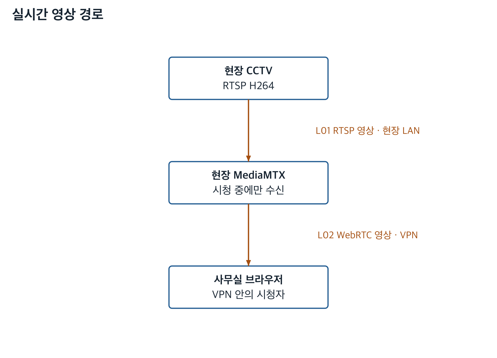

# DSC 실시간 CCTV 설치와 운영 안내

이 문서는 사무실 직원이 현장 CCTV를 브라우저로 시청하도록 설치하는 절차다. 현장 PC에 Python 게이트웨이와 MediaMTX 1.21.4를 설치하고, 회사 VPN 안에서 HTTPS와 WebRTC로 접속한다. 녹화 클립의 NAS 복제·S3 요청·다운로드는 기존 경로로 계속 동작한다. 새 소스와 설치 파일이 준비되어도 실제 회사 VPN·카메라·Cognito·NAS의 인수를 대신하지 않는다.

## 확인된 장비와 연결 조건

이전 대화의 시험 장비는 Hikvision DS-2CD2186G2-I, 주소 192.168.1.64다. 맥북은 임시 현장 PC이고 USB 유선망 192.168.1.10에서 카메라의 RTSP 재생과 H.264 영상 약 25초 녹화를 확인한 기록이 있다. 당시 메인 스트림 설정은 1920×1080, 4096 Kbps, H.264, H.264+ 끔이었다. 이 기록은 현재 연결 상태나 새 버전의 실시간 시청 검수 결과가 아니다.

메인 스트림 주소는 `rtsp://192.168.1.64:554/Streaming/Channels/101`이다. 설치 예제는 라이브용 서브스트림 `/Streaming/Channels/102`를 사용한다. 서브스트림 활성화·해상도·H.264·B-frame 없음은 설치할 카메라에서 확인한다. 분석용 메인 스트림의 화질을 임의로 낮추지 않는다. 읽기 전용 RTSP 계정을 따로 만들고 사용자명과 비밀번호는 현장 0600 파일로 관리한다. 고정형 카메라의 PTZ 제어는 제공하지 않는다.

최종 현장 PC의 OS·CPU, 사무실과 현장의 VPN 주소·정책, NAS 모델·공유 파일시스템, 동시 시청자 수는 확보한 기록에서 확정되지 않았다. 운영 Compose는 Linux와 Docker를 기준으로 한다. 맥북 Docker에서는 로컬 재현을 할 수 있지만 VPN 인터페이스 바인딩·RTSP 라우팅·재부팅 복구는 실제 설치 환경에서 확인한다.

## 구성과 권한



MediaMTX는 카메라의 압축 영상을 재인코딩하지 않고 전달한다. 기본 구성은 H.264 영상 단방향 시청이며 음성·PTZ·자동 화질 변환·HLS 대체·TURN 서비스는 제공하지 않는다. 코덱이 맞지 않으면 카메라 서브스트림 설정을 먼저 조정한다. 화면의 시청 종료는 라이브 연결만 종료하며 분석 프로그램의 녹화와 NAS 복제를 멈추지 않는다.

AWS에서 유효한 Cognito access token, `dsc/live.read`, 활성 등록 주체, `video=true`, 해당 카메라의 센터 또는 자산 권한을 모두 확인한다. VPN 접속만으로 시청을 허용하지 않는다. 라이브 권한은 기존 클립 권한에 scope를 추가하는 명시적 등록이다. 일반 파트너 client에는 새 scope를 자동 부여하지 않는다.

시청 토큰은 임의 비밀과 sessionId로 구성하고 DB에는 SHA-256만 저장한다. 브라우저는 WHEP Authorization 헤더로만 보낸다. RTSP 계정, Cognito client secret, 시청 토큰 원문은 로그·Git·AWS DB·URL 쿼리에 넣지 않는다. 게이트웨이는 등록된 현장 M2M 주체로 AWS에 확인하고 peer ID와 sessionId의 연결만 로컬 SQLite에 보관한다. 동일 토큰은 만료 전 재사용 가능한 capability이므로 노출 시 해당 시청 세션을 종료한다.

시청은 기본 최대 300초이며 발급에 사용한 Cognito access token의 만료를 넘지 않는다. 게이트웨이가 기본 5초마다 주체·카메라·자산·scope·세션을 재검사하고 무효 연결을 MediaMTX 제어 API로 종료한다. AWS 확인 실패도 연결 종료 조건이다. 검사 간격에 네트워크 timeout과 연결 종료 처리 시간이 더해지므로 5초 이내 종료를 보장하지 않는다. 제어 API 장애나 감독 스레드 오류는 MediaMTX 프로세스 종료로 처리한다. Docker 컨테이너 전체를 재시작하면 기존 연결은 종료되고 사용자는 다시 보기를 누른다.

## 설치 파일과 네트워크

| 항목 | 설정 또는 위치 |
|---|---|
| 이미지 | dsc-live-gateway:1.3.0, MediaMTX 1.21.4 digest 고정 |
| 설치 예제 | deploy/streaming 안의 Compose, 환경값, Nginx, 카메라 매니페스트 |
| 비밀·설정 | /etc/dsc-live, 파일 권한 0600, 컨테이너 UID/GID 10001 읽기 권한 |
| 영속 상태 | /var/lib/dsc-live, UID/GID 10001, 이벤트 outbox와 분리 |
| 공개 시청 | VPN 주소의 HTTPS 443 및 WebRTC UDP/TCP 8189 |
| 호스트 전용 | 127.0.0.1:8090 웹·인증, 127.0.0.1:8889 WHEP |
| 컨테이너 내부 | 127.0.0.1:9997 MediaMTX 제어 API |
| 아웃바운드 | 카메라 RTSP TCP 554, Cognito·AWS API HTTPS 443 |

VPN은 회사가 승인한 연결을 사용한다. 현장 카메라의 RTSP·관리 포트와 NAS SMB·NFS·관리 포트는 인터넷에 공개하지 않는다. 예제 VPN 주소 100.64.0.10은 샘플이다. 실제 VPN 인터페이스 주소에만 호스트 포트를 바인딩하고 방화벽에서 사무실 VPN 주체만 허용한다. Nginx HTTPS 인증서는 사무실 브라우저가 신뢰하는 발급 체인을 사용한다. TLS 검증을 끄지 않는다. VPN을 쓸 수 없으면 이 설치 구성을 그대로 인터넷에 공개하지 말고 TURN 또는 별도 중계 설계를 먼저 확정한다.

## 설치 순서

1. [설치 전 준비와 당일 검수](installation-readiness.md)의 등록표를 채운다. field 주체는 기존 `dsc/edge-server.work`를 사용한다. 사무실 archive 주체를 현장 스트리밍 주체로 재사용하지 않는다.
2. AWS에 새 DB 마이그레이션을 적용하고 grants.sql을 다시 적용한다. 신규 테이블은 live_cameras, live_sessions이며 기존 이벤트·작업·lease 테이블은 변경하지 않는다. 전환 전에 기존 데이터 건수·해시와 복구 지점을 기록한다.
3. CloudFormation의 LiveCallbackUrl에 시청 HTTPS 원점과 마지막 `/`를 지정한다. StaffClient의 기존 callback·logout은 보존된다. AllowedOriginsJson에는 실제 웹 화면 원점을 추가한다. 회사 IdP 설정은 유지한다.
4. 직원 등록에 `dsc/live.read`, `video=true`와 실제 센터·자산 범위를 추가한다. 등록 매니페스트는 일부 필드 PATCH가 아니므로 기존 주체의 전체 scope·권한을 보존해 작성한다. `examples/live-registration.json`은 기존 자산·field 설치에 카메라 연결만 추가하는 예제다.
5. 현장 설정 디렉터리에 live.env, installation.json, 카메라 계정 JSON과 기존 field client secret을 안전하게 공급한다. 카메라 RTSP 비밀번호의 특수문자는 생성 도구가 URL 인코딩한다. 카메라 계정 JSON은 생성 후 안전하게 별도 보관할 수 있다.
6. 대상 CPU에서 이미지를 빌드한다. 배포할 설정의 경로와 소유권을 맞추고 카메라 설정을 생성한다. 생성 도구는 기존 출력 파일을 덮어쓰지 않는다.

```sh
docker build -f deploy/streaming/Dockerfile \
  -t dsc-live-gateway:1.3.0 .
docker run --rm --user 10001:10001 \
  -v /etc/dsc-live:/etc/dsc \
  dsc-live-gateway:1.3.0 \
  dsc-live-config /etc/dsc/installation.json /etc/dsc/mediamtx.json
```

installation.json 안의 credentials_file은 위 컨테이너에서 보이는 `/etc/dsc/camera-1-credentials.json`으로 맞춘다. 호스트에서 생성 도구를 직접 실행할 때는 호스트 경로를 쓴다. 생성된 mediamtx.json에도 계정이 포함되므로 0600을 유지한다.

7. compose.env를 실제 VPN 주소와 호스트 경로로 작성한다. 설정과 상태 디렉터리는 먼저 만들고 서비스 UID 소유권을 부여한다. bind mount는 경로가 없으면 실패하도록 설정되어 있다.

```sh
docker compose --env-file /etc/dsc-live/compose.env \
  -f deploy/streaming/compose.yaml config --quiet
docker compose --env-file /etc/dsc-live/compose.env \
  -f deploy/streaming/compose.yaml up -d
```

8. 호스트 Nginx에 예제를 설치한다. server_name·VPN listen 주소·인증서·CSP의 API·Cognito·게이트웨이 원점을 실제 값으로 바꾼다. WHEP 경로만 MediaMTX로 전달하고 internal·publish·일반 미디어 페이지는 차단한다. `nginx -t` 후 reload한다. 카메라가 여러 현장에 있으면 각 게이트웨이의 webrtcAllowOrigins와 중앙 웹 화면의 gatewayOrigins·CSP에 승인한 원점을 맞춘다.
9. AWS LiveEnabled=true로 활성화한다. 사무실 브라우저에서 회사 계정 로그인 → 카메라 선택 → 실시간 보기 → 시청 종료를 확인한다. 로그인 access token은 메모리에만 두며 새로고침 시 다시 로그인한다. PKCE verifier와 state만 로그인 왕복 동안 sessionStorage에 보관한다.

## 장애 처리와 부하

기본 MediaMTX maxReaders는 카메라당 4명, 게이트웨이의 인증된 peer 상한은 32개다. 상한은 성능 보증이 아니다. 예를 들어 2Mbps 영상 네 개를 두 사람이 현장 게이트웨이에서 직접 시청하면 영상 페이로드만 약 16Mbps가 필요하다. 여기에 NAS 복제·이벤트·프로토콜 부하와 회선 여유를 더한다. 연결 수가 늘어도 카메라로부터는 경로당 하나의 입력을 공유한다.

회선 단절·프레임 정지는 화면에 표시하고 실시간 보기 버튼으로 재연결한다. 화면의 마지막 프레임을 현재 정상 영상으로 표시하지 않도록 정지 안내를 겹쳐 표시한다. 무제한 자동 재접속은 하지 않는다. 녹화 클립 전달의 재시도·outbox·lease 정책은 그대로 적용한다. 라이브 영상 손실은 저장된 클립의 무결성 실패와 구분한다.

운영 컨테이너는 CPU 1개·메모리 384MiB를 상한으로 시작한다. 대상 장비에서 분석·녹화·이벤트 접수·NAS 전송과 동시에 실행해 여유를 측정한다. 라이브 장애 시에는 스트리밍 Compose만 중지하고 기존 field·archive를 유지한다. 롤백은 LiveEnabled=false로 신규 발급을 차단하고 스트리밍 컨테이너를 중지하는 순서다. 이벤트 DB·outbox·NAS 디렉터리를 삭제하지 않는다.

## 검수와 참고 문서

개발자의 요청·응답·오류와 JSON 예제는 [실시간 API 명세](live-api-v1.3.md)를 따른다.

자동 검증은 tests/test_live.py, tests/test_streaming_gateway.py와 합성 브라우저 재현 스크립트를 사용한다. 브라우저 재현에는 Docker, 별도 설치된 Playwright와 해당 브라우저가 필요하다. 운영 이미지에는 시험용 OAuth 제공자를 포함하지 않는다. 시험 제공자는 tests/support/live_rehearsal.py를 임시 컨테이너에 명시적으로 마운트할 때만 실행한다.

```sh
PYTHONPATH=src python scripts/check_streaming.py \
  --output runtime/streaming-check/NEW_RUN \
  --browser-driver scripts/check_streaming_browser.cjs \
  --node /absolute/path/to/node
```

Playwright 모듈을 찾을 NODE_PATH와 필요하면 DSC_CHROME_EXECUTABLE을 시험 환경에서 지정한다. 재현은 합성 OAuth·합성 RTSP를 쓰며 실제 MediaMTX·Nginx·Chrome·제품 권한 코드를 거친다. 이 시험은 회사 Cognito 로그인·VPN·물리 CCTV·NAS 인수를 대신하지 않는다. 실제 카메라로 촬영 시각과 사무실 화면 표시 시각의 차이를 측정하고, 카메라 끊김·사무실 회선 단절·권한 회수·컨테이너 재시작·다중 시청을 AT26~AT30으로 기록한다.

[MediaMTX WebRTC](https://mediamtx.org/docs/read/webrtc), [브라우저 코덱과 연결](https://mediamtx.org/docs/features/webrtc-specific-features), [MediaMTX HTTP 인증](https://mediamtx.org/docs/features/authentication), [Cognito PKCE 로그인](https://docs.aws.amazon.com/cognito/latest/developerguide/authorization-endpoint.html)을 기준으로 구현했다. 설정과 제어 API는 고정 버전 1.21.4를 사용한다.
