# DSC 시스템 아키텍처 상세 설계

버전 1.2 문서 보완　작성일 2026년 11월 11일

이 시스템은 현장의 이벤트를 영속 수집하고 직원·허용된 파트너에게 이벤트·시계열·AAS 조회와 요청 클립을 제공한다. CCTV·로봇은 같은 코드의 독립 field 엣지로 동작하고 사무실 수신기가 NAS 사본을 확정한다. 요청된 클립은 사무실 archive 워커가 우선 업로드하며, 사무실 장애 시 같은 이벤트의 현장 사본을 가진 엣지가 예비 업로드한다. 기존 고객 조회와 AAS 기능은 이 구조에 계속 포함된다.

이 문서는 `docs/openapi.json`, 백엔드 API·AAS·작업·사본 코드, 엣지 수신·복제·업로드 코드와 `infra/` 템플릿을 대조한 구성 설명이다. API·JSON 계약은 [v1.2 연동 규격](aws-backend-edge-server-spec-v1.2.md)을 따른다. 이번 보완은 도식과 설명의 누락을 수정하며 실행 코드나 API 계약을 바꾸지 않는다. 물리 장비 설치 상태와 개발 AWS 실연동 결과는 [배포 기록](office-worker-deployment-v1.2.md)에 구분돼 있다.

## 1 도식 읽는 방법

구성도에서는 화살표를 요청·쓰기의 시작 방향으로 읽는다. `GET`과 파일 읽기는 요청 반대 방향으로 데이터가 돌아오는 같은 연결이다. 노드는 제목을 포함해 최대 두 줄이며 상세 역할은 별도 노드·연결과 본문 대응표로 설명한다. 순서도에서는 실선이 요청·처리, 회색 점선이 반환이고, 옅은 세로 점선은 참여자의 생명선이다. 생명선과 가로 메시지가 교차하는 지점은 새로운 네트워크 연결이나 분기가 아니다.

파랑은 제어 API·DB·큐 요청, 주황은 클립 전송·파일 접근, 보라는 토큰 발급, 빨간 점선은 조건부 예비 업로드다. 전체 구성도의 회색 점선 A02는 Cognito authorizer의 설정 관계이며 토큰을 발급하는 HTTP 호출이 아니다. 영역 테두리는 설치·관리 경계이고 전송의 시작점이 아니다. 각 기능 선은 명시된 구성 요소의 가장자리에 연결된다. 선의 식별자는 아래 대응표와 상세 절차를 연결한다.

`ApiFunction` 안의 이벤트·조회·AAS·작업·사본 처리는 하나의 FastAPI 애플리케이션에 있는 논리 기능이다. AAS를 별도 Lambda나 별도 DB로 배포하지 않는다. `MaintenanceFunction`은 별도 Lambda다. 상세 순서도의 `AWS 제어 API`는 읽기 편의를 위해 API Gateway·API Lambda·DB·SQS 처리를 한 열에 묶은 표현이며, 실제 AWS 리소스 구분은 전체 구성도와 배포 경로도를 따른다.

SQS는 CCTV·로봇·사무실별 큐와 DLQ를 사용한다. 기존 legacy 설치의 초기 큐는 별도로 유지한다. 큐 메시지는 중복되거나 늦게 도착할 수 있으므로 큐 수신만으로 작업 소유권을 인정하지 않는다. 최종 배정과 lease는 PostgreSQL에서 판정한다.

## 2 전체 구성과 제어 연결

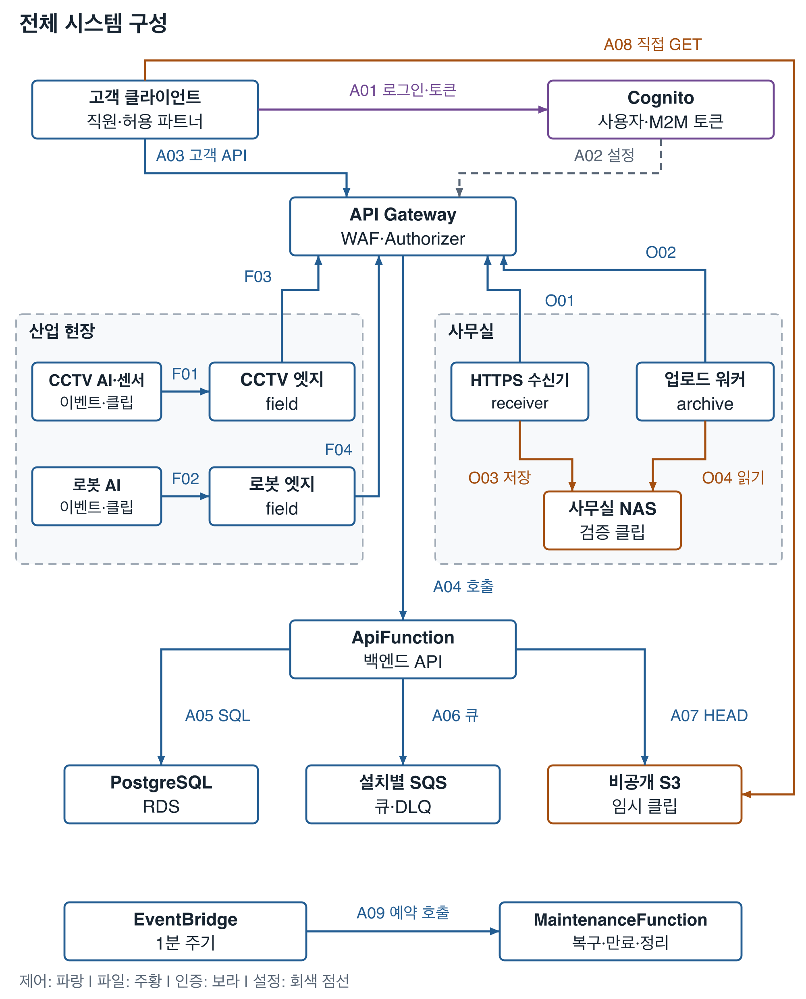

| 선 | 시작과 도착 | 의미와 확인 조건 |
|---|---|---|
| A01 | 고객 클라이언트 → Cognito | 직원은 authorization code + PKCE, 파트너 서버는 client_credentials. 설치별 field·archive도 각자 M2M 토큰을 발급받음 |
| A02 | Cognito → API Gateway authorizer | User Pool을 참조하는 설정 관계. 고객 로그인이나 영상 전송 경로가 아님 |
| A03 | 고객 → API Gateway | Bearer access token으로 이벤트·시계열·AAS 조회, 클립 요청·상태 조회 |
| F01·F02 | 각 AI·녹화 프로그램 → 해당 field 엣지 | 완성 JSON inbox, 생성 완료 클립과 localMedia 매핑. 입력 파일은 임시 작성·동기화 후 atomic rename |
| F03·F04 | 각 field 엣지 → API Gateway | 이벤트·media 상태·heartbeat, 사본 등록·전송 준비, 예비 작업 claim·lease·결과. JSON 제어 통신이며 클립 바이트는 포함하지 않음 |
| O01 | 사무실 수신기 → API Gateway | 수신기 자체 M2M 인증으로 전송 authorize·complete. field가 가져온 capability도 추가 확인 |
| O02 | 사무실 워커 → API Gateway | heartbeat와 작업 claim·lease·upload-url·complete·fail. SQS에 직접 접속하지 않음 |
| O03 | 수신기 → 사무실 NAS | 검증한 클립 바이트를 전용 루트에 확정. PC의 NAS 마운트 또는 NAS 내 로컬 파일 접근 |
| O04 | 사무실 워커 → 사무실 NAS | manifest와 허용 경로로 요청 클립 읽기. 응답 파일은 워커로 돌아옴 |
| A04 | API Gateway → ApiFunction | Lambda proxy integration. 백엔드가 JWT·허용 client·scope·활성 주체·센터·자산·영상 권한을 다시 검사 |
| A05 | ApiFunction → PostgreSQL | 인증·등록·자산·이벤트·영상·작업·사본·전송 정보 조회와 트랜잭션 저장. AAS도 같은 데이터 사용 |
| A06 | ApiFunction → 설치별 SQS | SendMessage, ReceiveMessage, ChangeMessageVisibility, DeleteMessage. 영상 바이트 대신 requestId·dispatchVersion 전달 |
| A07 | ApiFunction → S3 | 완료 시 HEAD로 ContentLength·ChecksumSHA256·ContentType 확인. PUT·GET URL 생성 자체는 SDK 서명 연산이며 영상 중계가 아님 |
| A08 | 고객 → S3 | API가 반환한 짧은 객체별 GET URL로 직접 다운로드. 바이트는 S3에서 고객에게 반환 |
| A09 | EventBridge → MaintenanceFunction | 1분 주기 예약 호출. 미수락·lease 만료·기한·재발행·객체 정리 처리는 9장 참조 |

### 2 1 백엔드 내부 연결

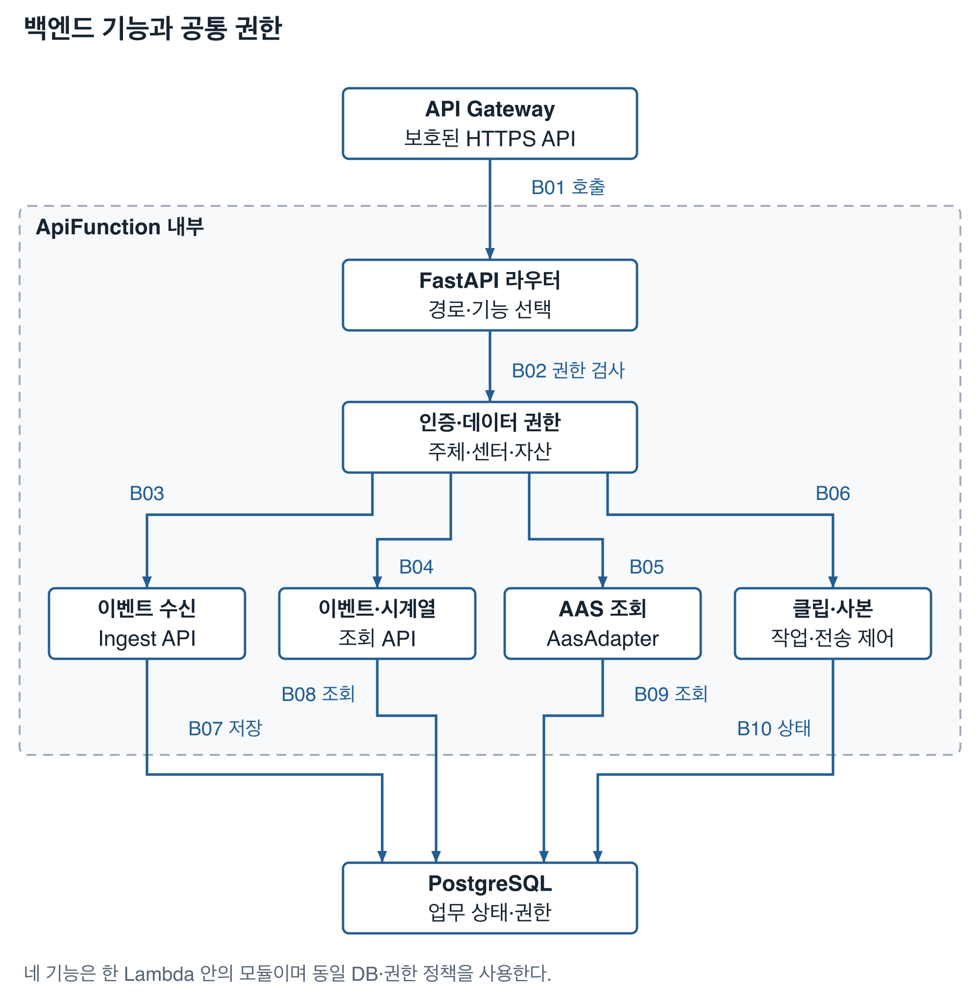

아래 기능은 ApiFunction 한 개 안의 처리 관계다. 각 API는 경계에서 토큰·기능 권한을 검사하고 서비스의 데이터 접근에서도 활성 주체·센터·자산 권한을 적용한다. 공통 권한 노드는 이 공통 정책을 표시하며, 인증을 한 번 통과하면 이후 검사를 생략한다는 뜻이 아니다.

| 선 | 시작과 도착 | 의미 |
|---|---|---|
| B01 | API Gateway → FastAPI 라우터 | Lambda proxy로 들어온 요청의 API 경로 선택 |
| B02 | 라우터 → 인증·데이터 권한 | JWT·client·scope·활성 주체·센터·자산 권한을 API와 서비스에서 검사 |
| B03 | 인증·데이터 권한 → 이벤트 수신 | 허용된 ingest와 media·heartbeat 입력 처리 |
| B04 | 인증·데이터 권한 → 이벤트·시계열 | 허용 범위의 목록·단건·현재값·기간 이력과 집계 |
| B05 | 인증·데이터 권한 → AAS 조회 | 허용된 Discovery·Registry·Shell·Submodel·값 조회 |
| B06 | 인증·데이터 권한 → 클립·사본 | 허용된 클립·작업·사본·전송·retire 처리 |
| B07 | 이벤트 수신 → PostgreSQL | 이벤트·자산 연결·초기 영상의 원자 저장과 상태 갱신 |
| B08 | 이벤트·시계열 → PostgreSQL | 같은 데이터 권한으로 이벤트·자산 조회 |
| B09 | AAS → PostgreSQL | 허용 자산·Submodel 메타데이터와 이벤트 조회 |
| B10 | 클립·사본 → PostgreSQL | 작업·배정·lease·사본·전송 상태를 잠금과 트랜잭션으로 관리 |

## 3 클립 바이트 경로와 저장 책임

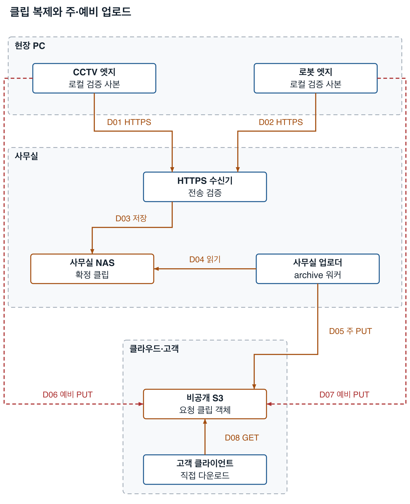

| 선 | 시작과 도착 | 프로토콜과 책임 |
|---|---|---|
| D01·D02 | 각 field → 사무실 HTTPS 수신기 | 전송별 capability, 허용 HTTPS 호스트, 실제 크기·SHA-256을 이용한 복제. 정확한 절차는 R04~R12 |
| D03 | 수신기 → NAS | 파일·디렉터리 fsync와 덮어쓰지 않는 원자 확정, 볼륨 마커 확인. manifest는 사무실 상태 DB에 기록 |
| D04 | 사무실 워커 → NAS | 허용 루트·manifest의 파일 읽기. NAS 공유·관리 포트는 인터넷에 공개하지 않음 |
| D05 | 사무실 워커 → S3 | 현재 lease에 발급한 이번 시도의 서명 PUT URL. 백엔드 완료 검증 전에는 READY가 아님 |
| D06·D07 | 해당 field → S3 | 사무실 장애 때 현장 관리 사본으로 직접 PUT. 사무실 NAS 접근이 필요하지 않으며 현장→AWS 독립 회선이 필요 |
| D08 | 고객 → S3 | READY 응답의 서명 GET URL로 다운로드. 이벤트·AAS API가 영상 바이트를 전달하지 않음 |

| 저장소 | 보관하는 정보 | 소유와 보존 기준 |
|---|---|---|
| AI·녹화 프로그램 입력 루트 | 프로그램이 만든 원본 클립 | 생성 프로그램이 관리. 로컬 접수 확정 전까지 변경·삭제하지 않으며 원본 정리는 생성 프로그램 정책 |
| field cacheRoot | 확정한 불변 관리 사본 | field 서비스 전용 영역. 기본 30일 이후에도 NAS 확인·작업 보호가 충족되지 않으면 보존 |
| field SQLite | receipts·outbox·manifest·clip_copies | 설치별 별도 상태. 서버 ACK 전 outbox는 일반 정리 대상이 아님 |
| 사무실 NAS | 수신 완료 검증 클립 | 서비스 전용 루트와 .dsc-volume-id 사용. 장기 보관·백업 정책은 현장 인수에서 확정 |
| 사무실 SQLite | 로컬 manifest·사본 상태·receipt | 수신기와 archive 워커가 같은 stateDir을 사용. NAS 파일 확정과 서버 보고를 재조정 |
| RDS PostgreSQL | 이벤트·자산·권한·영상 상태·작업·lease·사본·전송 | 업무 상태의 기준. NAS·현장의 로컬 파일 경로·NAS 비밀번호·영상 바이트는 저장하지 않음. S3 객체 키는 작업 메타데이터로 관리 |
| S3 ClipBucket | 요청된 클립의 시도별 객체 | READY 접근 기간 기본 24시간. 애플리케이션 만료·정리와 3일 lifecycle 안전망을 구분 |

NAS를 별도 PC에 마운트하면 PC가 수신기와 업로더를 실행한다. NAS가 필요한 Linux·컨테이너·POSIX 파일 기능을 지원하면 NAS 안에서 실행할 수 있다. 실행 위치가 달라도 receiver와 worker의 역할, NAS 전용 경로, 인증과 완료 확인은 같다. NAS 구입과 HTTPS 주소 준비는 별개이며, 수신 HTTPS는 수신기를 가리킨다.

## 4 고객 인증과 일반 조회 및 AAS

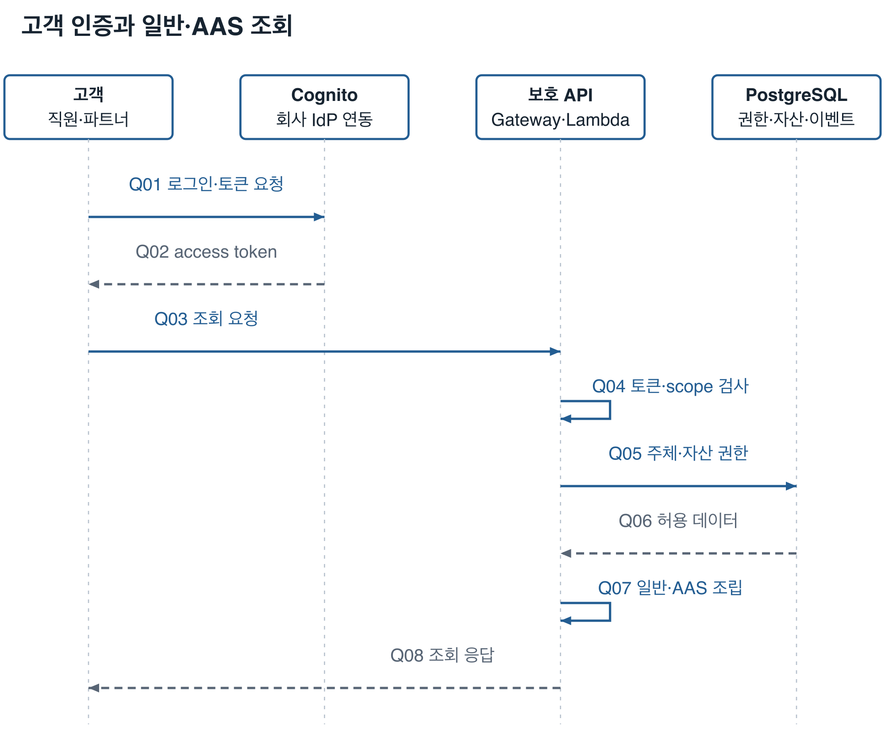

Q01~Q02의 직원 회사 계정 연동은 Cognito에 회사 IdP를 등록한 뒤 적용한다. 현재 템플릿이 회사 IdP를 자동 생성한다고 해석하지 않는다. 파트너·현장·사무실은 각각 별도 client_credentials 주체다. 브라우저 공개 client에 secret을 넣지 않는다.

Q03~Q08은 일반 조회와 AAS 조회에 공통인 인증·데이터 권한 흐름이다. 토큰이 유효해도 비활성 등록 주체는 거부한다. 요청의 siteId를 권한 근거로 사용하지 않는다. 이벤트 전체와 클립은 센터 전체 읽기 또는 연결된 모든 자산의 읽기 권한을 요구한다. 목록·집계는 같은 권한 필터 뒤에 계산한다.

| 고객 기능 | 실제 API | 필요한 기능 권한과 응답 |
|---|---|---|
| 이벤트 검색·단건 | GET /events, GET /events/{eventId} | dsc/timeseries.read와 센터·연결 자산 권한 |
| 현재값·기간 이력 | GET /timeseries/{assetId}/current, GET /timeseries/{assetId}/archive | dsc/timeseries.read와 자산 권한. 측정값·이력·기간 집계 |
| AAS 서비스 설명 | GET /description | dsc/aas.read. 제공하는 AAS 서비스 프로파일 |
| AAS Discovery | GET /lookup/shells | dsc/aas.read. 허용 자산의 식별 정보로 Shell ID 검색 |
| AAS Registry | GET /shell-descriptors, GET /shell-descriptors/{aasId} | 허용 자산·Submodel만 포함한 descriptor와 인증된 endpoint |
| AAS Shell | GET /shells/{aasId}, GET /shells/{aasId}/submodel-refs | 자산 식별 정보와 권한이 있는 Submodel 참조 |
| Submodel Registry | GET /submodel-descriptors/{submodelId} | 허용 Submodel descriptor |
| Submodel 본문·값 | GET /submodels/{submodelId}, GET /submodels/{submodelId}/$value | Nameplate·TechnicalData·TimeSeries. TimeSeries는 aas.read와 timeseries.read 모두 필요 |
| 클립 생성 요청 | POST /files/{eventId}/requests | dsc/timeseries.read와 등록된 video 권한, 이벤트 전체 권한 |
| 클립 상태·링크 | GET /file-requests/{requestId}, GET /files/{eventId} | 같은 읽기·video 권한. 조회 자체는 새 작업을 생성하지 않음 |

AAS는 등록 자산 메타데이터와 같은 PostgreSQL의 이벤트 조회를 사용해 응답을 조립한다. Nameplate·TechnicalData는 등록된 식별·사양값을 제공하고 TimeSeries는 현재·기간 조회와 연결된다. AAS ID는 등록 URI를 base64url로 인코딩해 경로에 사용한다. 권한 없는 TimeSeries는 Shell 참조와 Registry에서도 제외한다. AAS endpoint에 NAS 경로나 S3 서명 URL을 저장하지 않는다. AAS에서 이력이나 클립을 따라가도 자체 API의 인증·권한 검사를 다시 받는다.

### 4 1 AAS 기능과 데이터 연결

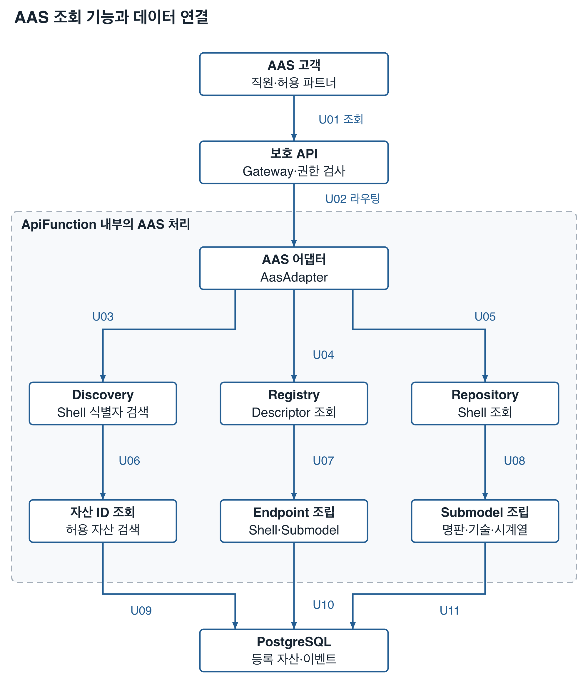

U03~U08은 AAS 기능 분기와 데이터 조립 관계다. Discovery·Registry·Repository를 차례로 호출해야 한다는 필수 순서를 의미하지 않는다. Repository는 같은 AasAdapter가 제공하는 Shell·Submodel 조회 기능이며 별도 서버를 생성하지 않는다. `/description`은 같은 보호 API의 서비스 설명 응답이다.

| 선 | 시작과 도착 | 의미 |
|---|---|---|
| U01 | 고객 → 보호 API | Bearer access token과 aas.read로 AAS 조회 |
| U02 | 보호 API → AAS 어댑터 | Gateway authorizer와 백엔드 권한을 확인한 AAS 경로 처리 |
| U03 | 어댑터 → Discovery | 식별 조건으로 허용된 Shell ID 검색 |
| U04 | 어댑터 → Registry | Shell·Submodel descriptor 조회 |
| U05 | 어댑터 → Repository | Shell·참조·Submodel 본문·값 조회 |
| U06 | Discovery → 자산 ID 조회 | URI와 등록 자산에 권한 필터 적용 |
| U07 | Registry → Endpoint 조립 | 허용된 Shell·Submodel과 인증된 endpoint만 응답 |
| U08 | Repository → Submodel 조립 | Nameplate·TechnicalData·TimeSeries와 $value 조립 |
| U09 | 자산 ID 조회 → PostgreSQL | 등록 식별자와 허용 자산 검색 |
| U10 | Endpoint 조립 → PostgreSQL | 자산·Submodel 공개 범위·권한 조회 |
| U11 | Submodel 조립 → PostgreSQL | 등록 사양과 이벤트 기반 시계열 조회 |

## 5 로컬 접수와 NAS 복제의 무결성

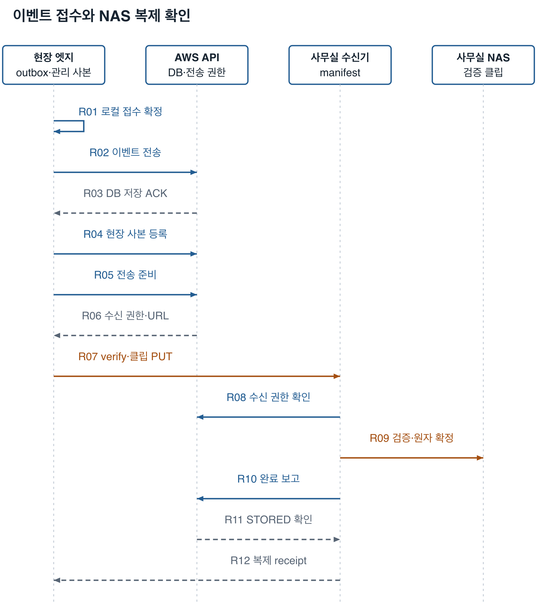

R01은 파일 생성 완료를 전제로 하는 접수다. field는 임시 JSON을 읽지 않으며 클립을 관리 영역에 확정하고 SQLite 트랜잭션으로 outbox·매핑·사본 정보를 기록한다. 입력의 accepted 이동은 로컬 접수 완료이고 서버 저장 완료는 R03의 ACK다. RECORDING 이벤트를 먼저 보냈다면 생성 완료 후 별도 PUT /ingest/events/{eventId}/media를 순서대로 전송한다.

R02~R03은 이벤트·자산 연결·초기 영상 정보를 한 DB 트랜잭션으로 저장한다. 응답 유실 시 같은 eventId와 최초 본문으로 재전송한다. 같은 ID의 다른 본문은 409로 거부한다. 이후 media revision 갱신은 최초 이벤트 본문을 변경하지 않는다.

R04는 현장 사본을 등록하고 R05~R06은 담당 사무실과 정확한 내용에 묶인 전송 권한을 발급한다. capability는 transferId·발신자·수신자·eventId·clipId·revision·크기·해시에 한정되고 서버에는 토큰 해시를 저장한다. field는 반환된 HTTPS 호스트를 설치 allowlist와 대조한다.

R07은 먼저 POST /archive/transfers/{transferId}/verify를 호출한다. 기존 파일이 없으면 404를 받고 PUT /archive/transfers/{transferId}로 보낸다. verify와 PUT 각각에서 수신기는 자체 Cognito JWT로 POST /edge-server/archive/{transferId}/authorize를 호출한다. R09는 허용 루트와 볼륨을 확인하고 실제 바이트를 검증한 뒤 파일·디렉터리를 동기화하고 원자적으로 확정한다. verify는 기존 파일을 실제로 다시 읽는다.

R10~R12는 로컬 manifest를 기록한 뒤 POST /edge-server/archive/{transferId}/complete로 서버의 STORED 확인을 받고 field에 receipt를 반환한다. field도 식별자·revision·크기·해시·수신자·STORED를 대조하고 로컬 상태를 기록한다. 파일만 있거나 전송만 끝났다는 이유로 복제 완료를 인정하지 않는다.

NAS 파일·사무실 SQLite·클라우드 DB를 하나의 분산 트랜잭션으로 묶지는 않는다. 각 단계의 영속 기록과 같은 내용의 재검증·재시도로 확정 사이의 장애를 조정한다. 부분 파일은 최종 사본으로 노출하지 않고, 같은 경로의 다른 내용을 덮어쓰지 않는다. 파일 확정 후 manifest·서버 보고·field ACK 중 하나가 유실돼도 기존 파일을 재검증해 조정한다.

## 6 클립 요청과 작업 처리 및 고객 다운로드

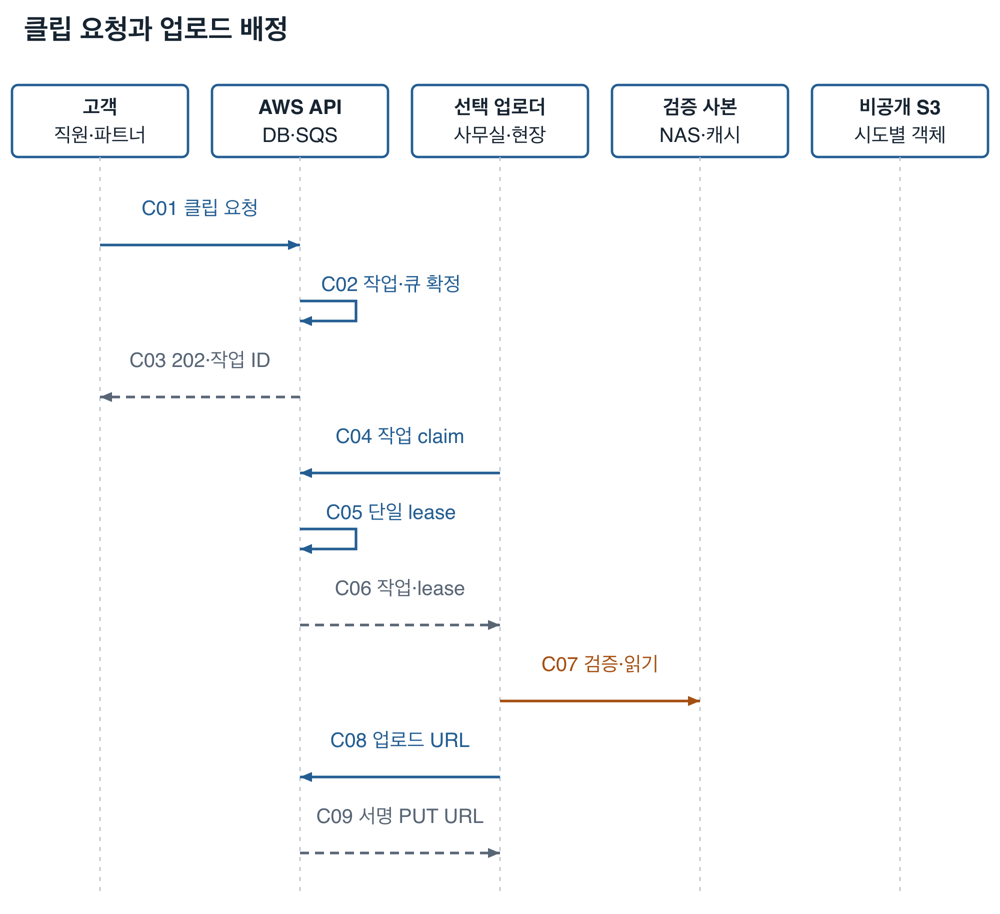

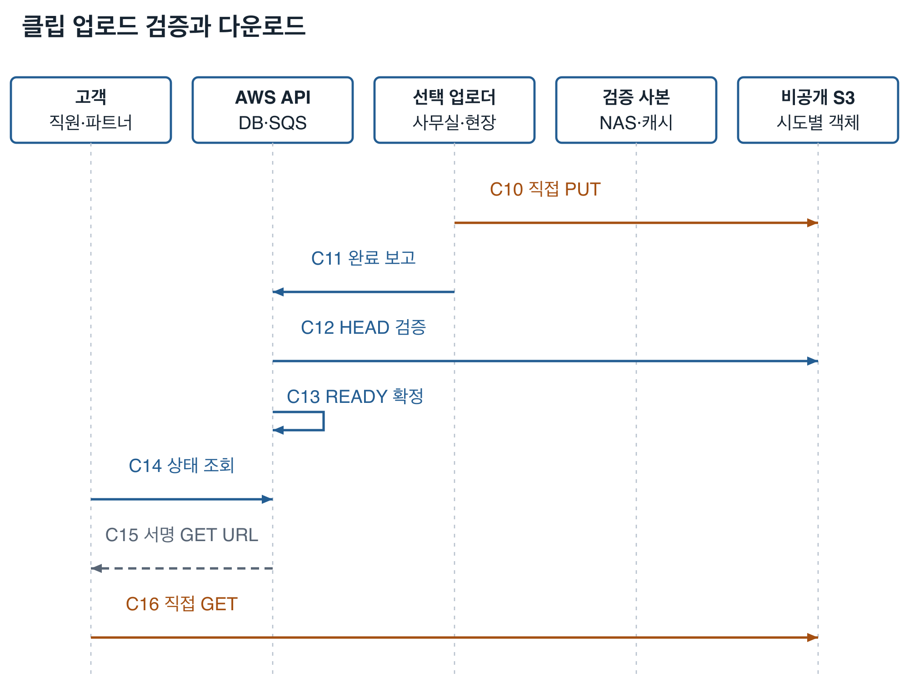

C01~C03은 고객 요청이다. 클립이 AVAILABLE이고 읽기·video 권한을 만족하면 활성 작업을 재사용하거나 신규 작업을 DB에 저장한다. 신규 작업은 202와 requestId·statusUrl을 반환한다. 이미 유효한 READY 객체가 있으면 200으로 재사용한다. DB 저장 뒤 SQS 발행에 실패해도 영속 배정 표식을 유지하고 유지관리에서 재발행한다.

C04~C06에서 업로더는 POST /edge-server/jobs/claim을 호출한다. API Lambda가 해당 설치 큐를 수신하고 DB 잠금 아래 현재 배정·dispatchVersion·권한·lease를 검사한다. 유효 lease 하나만 허용하며 빈 배정은 204다. 엣지와 사무실 워커는 SQS 자격 증명을 갖지 않는다. 큐가 업로더로 직접 PUSH하거나 SQS가 Lambda를 자동 트리거하는 구조도 아니다.

C07~C10은 현재 사본을 검증하고 POST /edge-server/jobs/{requestId}/upload-url로 이 시도의 PUT URL을 발급받아 S3에 직접 업로드한다. 장시간 처리 중에는 POST /edge-server/jobs/{requestId}/lease로 갱신한다. 원격 NAS 파일과 field cache 중 배정된 업로더의 로컬 경로만 읽는다. 영상은 API Gateway·Lambda·DB를 경유하지 않는다.

C11~C13은 POST /edge-server/jobs/{requestId}/complete 뒤 실제 S3 HEAD를 대조하는 단계다. ContentLength·ChecksumSHA256·ContentType, 현재 lease·revision·요청자와 업로더 권한을 확인하고 외부 HEAD 이후에도 기한을 재확인한 뒤 READY로 전환한다. ETag를 SHA-256으로 취급하지 않는다. 실패는 POST /edge-server/jobs/{requestId}/fail로 보고한다.

C14~C16에서 고객은 상태 API를 폴링한다. QUEUED·UPLOADING은 202, READY·FAILED·EXPIRED는 200과 해당 상태다. READY 링크는 남은 접근 기간 안에서 최대 5분이며 고객이 S3에 직접 GET한다. READY 접근 기간은 기본 24시간, PUT URL은 기본 최대 15분, 작업 전체 기한은 30분·최대 3회다. S3 3일 lifecycle은 고아 객체의 물리 정리 안전망이며 24시간 API 접근 만료를 대신하지 않는다.

이미 발급된 S3 서명 URL은 URL 자체의 만료·객체·AWS 정책 조건에 따라 동작한다. 앱의 권한 변경이 이미 발급된 URL을 즉시 취소한다고 약속하지 않는다. 이후 API 호출·새 URL 발급은 변경된 권한으로 검사하고 GET URL을 짧게 제한한다.

## 7 사무실 장애와 예비 업로드

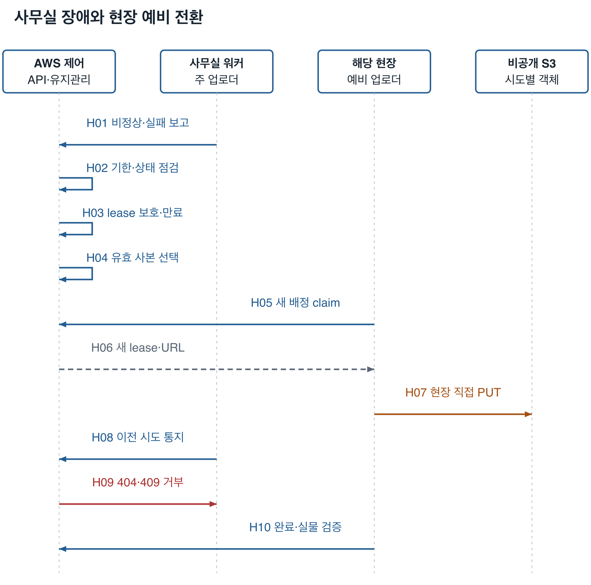

H01~H04는 사무실의 명시적 실패·NAS 비정상·heartbeat 단절·미수락·lease 기한을 판정한다. 현재 유효 lease를 가진 작업은 건강 상태만 보고 다른 업로더가 동시에 완료하도록 허용하지 않는다. 실패 또는 만료로 재시도할 수 있게 된 뒤 새로운 배정과 시도를 만든다.

예비 후보는 해당 이벤트 발신 엣지와 그 엣지에 등록한 사무실 archive 중 같은 revision·크기·SHA-256의 PRESENT 사본을 가진 건강한 설치다. 사무실을 우선하고 장애·미수락·재시도 때 다른 유효 후보를 선택한다. CCTV 클립은 그 CCTV field 사본, 로봇 클립은 그 로봇 field 사본이 예비 경로다. 같은 코드라는 이유로 다른 엣지가 보유하지 않은 파일을 대신 업로드할 수는 없다.

H05~H10은 새 dispatchVersion·attempt·lease와 시도별 S3 키로 전환한다. 오래된 claim·lease·upload-url·complete·fail은 현재 작업을 바꾸지 못한다. 이미 발급된 이전 PUT URL이 남아 있어도 이전 객체 키로만 기록되며 새 시도의 READY 객체를 덮어쓰지 않는다. 이전 객체는 해당 URL과 작업 기한의 안전 조건이 지난 뒤 정리한다.

| 설정 | 기본값 | 전환에 미치는 의미 |
|---|---|---|
| heartbeat 주기 | 60초 | 현장·사무실이 상태와 저장소 건강 보고 |
| 건강 상태 유효 기간 | 180초 | 마지막 서버 수신 시각과 NAS OK를 함께 사용 |
| 작업 claim 주기 | 5초 | 배정 큐를 자체 API로 반복 확인 |
| 미수락 배정 기한 | 60초 | 유지관리에서 다른 유효 사본으로 재배정 가능 |
| lease | 300초, 60초마다 연장 | 종료·단절 후 만료를 기다려 안전하게 다음 시도 허용 |
| 유지관리 | 1분 | 탐지·재배정에는 주기와 기한의 지연이 더해짐 |

## 8 현장 30일 사본 정리

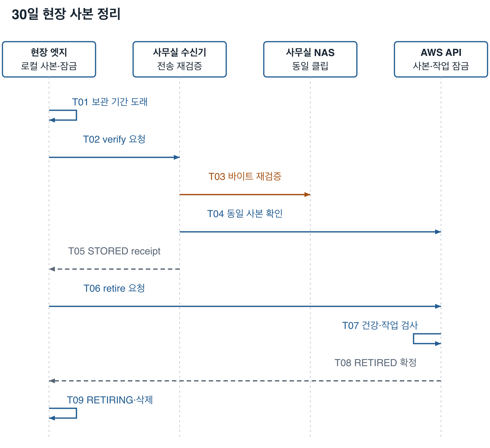

T01~T05는 클립 endedAt 기준 기본 30일이 지난 관리 사본에 대해 NAS의 실제 파일을 다시 읽고 STORED receipt를 확인한다. T06~T08은 POST /edge-server/replicas/retire에서 사본·이벤트 단위 잠금과 진행 중 작업 보호, 같은 NAS 사본, 사무실 건강·권한을 검사한다. 서버가 이 현장 사본을 RETIRED로 바꿔 신규 배정을 막은 뒤에만 T09의 로컬 RETIRING·파일 삭제·DELETED를 진행한다.

retire 응답 유실이나 삭제 도중 재시작은 같은 retire 요청과 RETIRING 상태로 조정한다. NAS 미확인·미전송·변조·작업 진행 중에는 보존한다. 격리는 성공이나 삭제를 뜻하지 않는다. 운영자가 원인을 해결하고 inspect-copies·retry-copy로 명시적으로 복구한다.

30일은 최소 보관·정리 조건이며 사용량 상한이 아니다. 일별 최대 클립량 × 30일, 미복제 장애 누적량과 여유 공간을 확보한다. 원본과 관리 사본이 같은 디스크에 있으면 두 파일을 합산한다. 생산 원본 삭제는 생성 프로그램의 보관 정책에 따르고 NAS의 장기 백업·보관은 별도로 정한다.

## 9 AWS 배포와 관측 및 권한

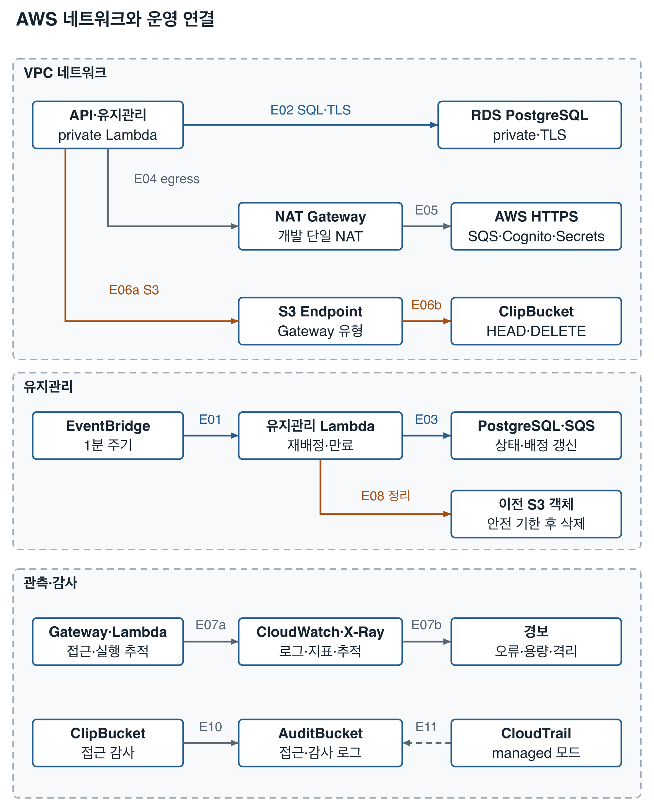

| 관계 | 시작과 도착 | 구현과 관리 경계 |
|---|---|---|
| E01 | EventBridge 규칙 → MaintenanceFunction | SAM Schedule, rate(1 minute). Lambda 서비스가 함수를 실행 |
| E02 | 두 함수 → RDS | private 주소·TLS 5432, 런타임 DB 계정과 제한된 SQL 권한 |
| E03 | 유지관리 → DB·SQS | 기한·lease 상태 변경, 미수락 배정·발행 실패 조정, 설치별 큐 재발행 |
| E04·E05 | 두 함수 → NAT → AWS HTTPS endpoint | SQS·Secrets Manager·Cognito JWKS 등 외부 HTTPS. NAT는 개발 public subnet에 한 개 |
| E06a·E06b | 두 함수 → S3 Gateway Endpoint → ClipBucket | private route table을 통한 S3 HEAD·DELETE. 외부 업로더·고객의 PUT·GET은 이 VPC 경로를 거치지 않음 |
| E08 | 유지관리 → S3 이전 시도 객체 | 현재 작업과 살아 있는 PUT URL을 보호한 뒤 삭제. DB 만료가 물리 삭제와 같은 순간이라고 가정하지 않음 |
| E07a·E07b | Gateway·함수 → CloudWatch·X-Ray → 경보 | 접근·실행 로그, 오류·격리·디스크 부족 지표와 추적. 직원·파트너 메시지 자동 발송은 구현 범위 밖 |
| E10 | ClipBucket → AuditBucket | S3 서버 접근 로그 기록 |
| E11 | CloudTrail → AuditBucket | ClipAuditMode=managed일 때 클립 데이터 이벤트 기록. external은 운영 측 보장을 사용하고 synthetic 개발에서는 합성 클립만 허용 |
| E09 | 각 실행 역할·주체 → 허용 서비스·데이터 | 아래 권한표. 네트워크 연결선과 IAM 허용 관계는 구분 |

| 실행 주체 | 인증·허용 범위 | 보유하지 않는 권한 |
|---|---|---|
| 직원 클라이언트 | Cognito 사용자 access token, 담당 센터·자산·기능 | DB·SQS 직접 자격 증명, 브라우저 client secret |
| 파트너 서버 | 별도 Cognito client, 공개 Submodel·등록 자산. 이력·video는 별도 허용 | scope만으로 전체 센터·모든 영상 접근 |
| 각 field 엣지 | 설치별 Cognito client와 secret 파일, 해당 발신 자산·사본·배정 작업 | AWS 장기 access key, 다른 설치의 임의 작업 |
| 사무실 receiver·worker | archive 설치 인증, 담당 이벤트의 모든 연결 자산, 전송 capability 추가 검사 | 미등록 field·다른 센터 파일의 임의 수신·업로드 |
| ApiFunction | 전용 IAM 역할, 런타임 DB·cursor secret, 해당 큐·클립 버킷 작업 | 마스터 DB 비밀·NAS 마운트·영상 중계 |
| MaintenanceFunction | 별도 IAM 역할, 만료·배정·정리에 필요한 DB·SQS·S3 범위 | 고객 로그인·NAS 접근·영상 중계 |
| 일회성 DB 초기화 | 개발 마이그레이션용 별도 역할·비밀 | 상시 API 또는 공개 함수 URL로 노출. 적용 후 스택 삭제 |

개발 네트워크는 두 private subnet과 단일 public NAT, S3 Gateway Endpoint를 사용한다. RDS 개발 배포는 MultiAZ=false이며 비공개·암호화·TLS·백업·삭제 보호를 적용한다. 사무실 예비 업로드가 AWS 전체 장애나 개발 NAT·DB의 고가용성까지 해결하는 것으로 표시하지 않는다. 운영 승격에서는 AZ별 egress·DB 가용성·용량·백업 복구 목표를 별도 검수한다.

Route 53·ACM·API Gateway custom domain은 DomainName·HostedZoneId·CertificateArn을 준비한 경우의 선택 구성이다. 운영 목표 주소는 dsc.f2x.ai이고 현재 개발 API는 execute-api 주소를 사용한다. WAF는 REST API stage에 연결되며 별도 영상 프록시 서버가 아니다. NAS HTTPS는 사무실 프록시·VPN과 해당 TLS 인증서를 따로 준비한다.

## 10 장애별 보존과 실제 한계

| 상황 | 보존되는 상태와 처리 | 가용성 또는 인수 조건 |
|---|---|---|
| 현장→AWS 단절 | 같은 ID·본문의 outbox·관리 사본 보관 후 재전송 | 로컬 디스크가 살아 있고 누적 공간이 필요 |
| 현장→사무실 단절 | NAS 복제 재시도, 건강한 field가 S3 예비 업로드 | field→AWS 회선이 사무실 회선과 독립적이어야 함 |
| 사무실 워커만 종료 | NAS 파일은 유지, 기한·lease 후 field 전환 | 별도 워커를 NAS에 붙이거나 기존 워커 복구 가능 |
| NAS 고장·마운트 이탈 | 볼륨 마커·실제 읽기 실패로 성공·정리 차단 | 보관 중 field 사본이 있으면 예비 제공, 실제 NAS 복구 필요 |
| 수신 중 정전·ACK 유실 | 임시 파일·manifest·서버 상태를 재검증하고 같은 내용으로 조정 | 실제 NAS fsync·hard link·전원 복구 검수 필요 |
| 중복 큐·동시 claim | DB 배정·dispatchVersion·lease로 단일 유효 처리자 | PostgreSQL 잠금·원자 갱신 전제 |
| 이전 시도 PUT·완료 도착 | 시도별 객체 키, 현재 lease·revision 검사로 READY 오염 차단 | 이전 URL은 자체 기한까지 남을 수 있음 |
| 파일 변조·권한 회수 | 성공·정리 거부, 격리·운영 재처리, 새 URL 발급 차단 | 이미 발급된 짧은 URL의 잔여 유효 시간은 별도 |
| 디스크 부족 | 미확인·미전송을 지우지 않고 오류·경보 | 신규 파일 접수·녹화도 실패할 수 있어 확장·복구 필요 |
| field 보관 기간 이후 NAS 장애 | cloud 이벤트 조회는 유지 | NAS 백업·남은 S3 객체 범위 밖 클립은 제공 불가 |
| 현장·사무실 동시 파일 손실 | 남은 S3·별도 백업 범위로 복구 | 본 복제만으로 동시 손실을 복원할 수 없음 |

물리 NAS와 현장 장비는 아직 준비 전이다. 실제 공유 프로토콜의 파일 영속성, 독립 회선, HTTPS 인증서, 강제 종료·정전·부하·30일 용량, NAS 백업 복원 및 RPO/RTO는 설치 후 AT25로 인수한다. 설계상의 처리 경로, 자동 시험, 실제 AWS 실연동, 물리 현장 검수 완료를 서로 바꾸어 보고하지 않는다.

## 11 도식 원본과 재생성 및 검증

편집 가능한 SVG와 PNG는 docs/diagrams의 같은 이름으로 보관한다. 과거 v1.1 규격의 architecture.svg·architecture.png는 당시 구성의 기록으로 유지하고 최신 진입점은 본 문서와 architecture-v1.2다. diagrams 생성기는 scripts/render_architecture.py이며 Pillow와 Nanum Gothic TrueType 폰트가 있는 문서 작업 환경에서 실행한다.

```sh
python scripts/render_architecture.py --font /path/to/NanumGothic-Regular.ttf
# Sharp가 있는 문서 작업용 Node 환경과 한글 폰트 설정을 사용한다.
node scripts/rasterize_architecture.cjs
# python-docx와 Pillow가 있는 문서 작업 환경에서 원래 양식으로 작성한다.
python scripts/build_architecture_docs.py
```

SVG를 PNG로 렌더링해 모든 그림을 시각 확인한다. 모든 노드는 제목을 포함해 두 줄 이하인지 생성 시 검사한다. 구성도·백엔드 내부·AAS·저장 경로·AWS 경로는 시작·종료의 노드 가장자리 연결, 다른 노드·선·경계 제목·설명 관통과 선의 겹침을 검사한다. 순서도는 행별 메시지와 줄바꿈 폭을 확인하고 메시지 문구는 생명선 사이에 배치한다. 생명선 교차를 기능 선의 분기로 보지 않는다. Word는 기존 A4 세로 용지·여백·스타일·머리말·꼬리말을 유지하고 그림을 본문 폭 안에 배치한다. 전체 구성과 백엔드·AAS 내부 기능을 여러 그림으로 나누며 용지 확대나 가로 전환을 사용하지 않는다.

Word 생성기는 v1.1 규격서의 양식을 기준으로 사용한다. 스타일 정의와 단일 A4 섹션의 용지·여백·머리말·꼬리말 위치가 원본과 같은지, 모든 그림이 본문 폭 안인지 검사한다. 버전과 문서명 외의 꼬리말 형식과 PAGE 필드는 유지한다. 표는 원본의 검은 테두리·흰 제목 행·글꼴·셀 여백을 사용한다.

## 12 코드와 API 대응

| 기능 | 근거 파일 | 해당 도식 |
|---|---|---|
| 보호 API·CORS·AAS 라우팅 | src/dsc/backend/api.py, docs/openapi.json | 전체 구성·고객 조회 |
| AAS 모델·Registry·Discovery·TimeSeries 조립 | src/dsc/backend/aas.py, schemas/properties-v1.json | 고객 조회 |
| 인증·주체·센터·자산·video 권한 | src/dsc/backend/auth.py | 고객 조회·클립·복제·전환 |
| 이벤트·작업·lease·배정·만료 | src/dsc/backend/service.py | 복제·클립·전환 |
| 사본·전송 capability·정리 보호 | src/dsc/backend/replicas.py | 복제·정리 |
| 로컬 접수·상태·파일 확정 | src/dsc/edge/worker.py, store.py, files.py | 복제·정리 |
| NAS 수신·재검증 | src/dsc/edge/archive.py | 복제·정리 |
| field 복제·retire·복구 | src/dsc/edge/replication.py | 저장 경로·복제·정리 |
| S3·SQS 실제 호출 | src/dsc/backend/aws.py, src/dsc/edge/worker.py | 클립·AWS 배포 |
| 앱·네트워크·DB 리소스 | infra/template.yaml, dev-network.yaml, database.yaml | 전체 구성·AWS 배포 |

아래 목록은 2026년 11월 11일 OpenAPI의 29개 HTTP 작업 전체와 사무실 수신기 전용 2개 작업을 연결한다. 경로 변수의 eventId·requestId 표기는 설명용이며 실제 OpenAPI 매개변수 이름은 파일의 snake_case를 그대로 따른다.

| 처리 그룹 | HTTP 작업 | 관련 흐름 |
|---|---|---|
| 이벤트 | POST /ingest | R02~R03 |
| 녹화 상태 | PUT /ingest/events/{event_id}/media | R01~R03 생성 완료 후 갱신 |
| 상태 보고 | POST /edge-server/heartbeat | F03·F04·O02, H01~H04 |
| 고객 조회 | GET /events, GET /events/{event_id} | Q03~Q08 |
| 시계열 | GET /timeseries/{asset_id}/current, GET /timeseries/{asset_id}/archive | Q03~Q08 |
| 클립 요청·조회 | POST /files/{event_id}/requests, GET /files/{event_id}, GET /file-requests/{request_id} | C01~C03, C14~C16 |
| 작업 claim | POST /edge-server/jobs/claim | C04~C06, H05 |
| lease | POST /edge-server/jobs/{request_id}/lease | C08, H08~H09 |
| PUT URL | POST /edge-server/jobs/{request_id}/upload-url | C08~C09 |
| 완료·실패 | POST /edge-server/jobs/{request_id}/complete, POST /edge-server/jobs/{request_id}/fail | C11~C13, H01·H08~H10 |
| 사본 등록·정리 | POST /edge-server/replicas, POST /edge-server/replicas/retire | R04, T06~T09 |
| 전송 준비 | POST /edge-server/archive/prepare | R05~R06 |
| 전송 권한·완료 | POST /edge-server/archive/{transfer_id}/authorize, POST /edge-server/archive/{transfer_id}/complete | R08·R10~R12, T04 |
| AAS 설명·검색 | GET /description, GET /lookup/shells | Q03~Q08 |
| AAS Registry | GET /shell-descriptors, GET /shell-descriptors/{aas_id} | Q03~Q08 |
| AAS Shell·참조 | GET /shells/{aas_id}, GET /shells/{aas_id}/submodel-refs | Q03~Q08 |
| AAS Submodel | GET /submodel-descriptors/{submodel_id}, GET /submodels/{submodel_id}, GET /submodels/{submodel_id}/$value | Q03~Q08 |
| 사무실 수신기 전용 | PUT /archive/transfers/{transfer_id}, POST /archive/transfers/{transfer_id}/verify | R07~R12, T02~T05. API Gateway의 경로가 아님 |
