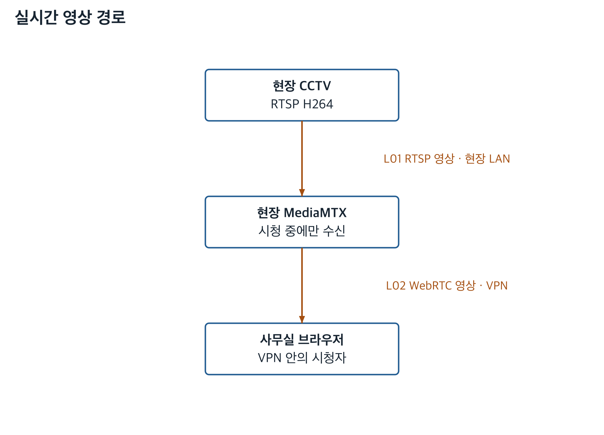
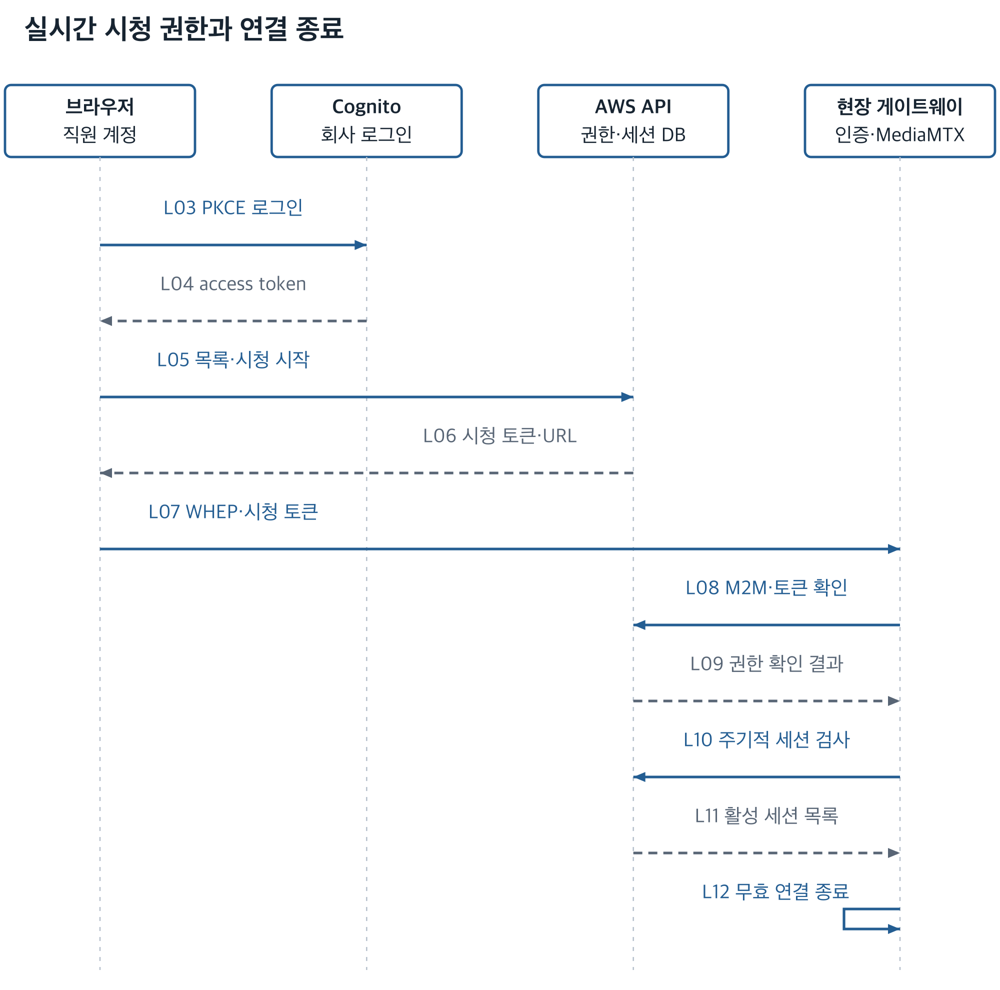

# DSC 시스템 아키텍처와 실시간 시청 설계

v1.3은 v1.2의 이벤트·시계열·AAS 조회와 녹화 클립 전달에 사무실의 실시간 시청을 추가한다. 기존 ApiFunction 안에 라이브 제어 API를 더하고, 현장에는 독립 스트리밍 컨테이너를 설치한다. 기존 11개 상세 도식과 A·F·O·R·C·T·E 관계는 [v1.2 상세 설계](system-architecture-v1.2.md)에 유지하며 이 문서의 L01~L12 관계가 추가된다. API 계약은 [v1.3 규격](aws-backend-edge-server-spec-v1.3.md)을 따른다.

## 실제 배포 단위와 고객 기능

| 실행 단위 | 담당 기능 | 기존 고객 기능과의 관계 |
|---|---|---|
| AWS ApiFunction | 이벤트, 조회, AAS, 클립 작업, 사본, 추가 라이브 세션 | 같은 DB·인증·자산 권한 사용 |
| AWS MaintenanceFunction | 클립 재배정·만료·객체 정리 | 라이브 영상 바이트를 처리하지 않음 |
| CCTV 및 로봇 field | inbox, outbox, 관리 사본, NAS 복제와 예비 업로드 | 기존 실행·상태 경로 유지 |
| 사무실 수신기·archive | NAS 파일 확정, 사본 확인, 요청 클립 S3 업로드 | 기존 주 업로더 유지 |
| 추가 live 컨테이너 | Python 인증 감시와 MediaMTX 하위 프로세스 | 별도 CPU·메모리·상태 영역 |
| 현장 호스트 Nginx | VPN HTTPS 웹·WHEP 경계 | NAS 수신 프록시와 별도 주소·설정 |
| 사무실 브라우저 | Cognito PKCE 로그인과 WebRTC 재생 | 카메라별 권한 있는 직원 시청 |

원하는 시각의 녹화 클립은 NAS와 S3 경로를 사용하고 현재 카메라 영상은 현장 MediaMTX에서 받는다. NAS 장애로 과거 클립 조회가 영향을 받아도 현장·VPN·인증이 정상이라면 라이브를 볼 수 있다. 현장 PC 또는 카메라가 중단되면 라이브는 중단되며, 저장된 클립은 기존 주·예비 가용성 조건을 따른다. field와 live가 같은 PC를 쓰면 PC 고장은 공통 장애다.

## 실시간 영상 바이트

| 선 | 시작과 도착 | 방향과 의미 |
|---|---|---|
| L01 | 카메라 → 현장 MediaMTX | 영상 바이트 방향. MediaMTX가 현장 LAN의 RTSP TCP 연결을 시작해 영상을 읽음 |
| L02 | 현장 MediaMTX → 사무실 브라우저 | WebRTC DTLS/SRTP 영상 방향. 회사 VPN으로 도달 가능한 UDP/TCP 8189 사용 |

그림의 선은 영상 바이트 방향이다. RTSP 요청 시작은 L01의 반대이고, WebRTC 연결 협상은 아래 L07~L09의 제어 관계다. 현장·사무실 영역 테두리에 화살표를 연결하지 않는다. NAS 클립 복제와 S3 업로드는 위 그림에 포함하지 않았으며 기존 R·C 관계를 계속 사용한다.

## 로그인과 시청 제어

| 선 | 시작과 도착 | 의미 |
|---|---|---|
| L03 | 브라우저 → Cognito | 회사 IdP를 포함한 code grant와 S256 PKCE 로그인 |
| L04 | Cognito → 브라우저 | 검증된 code 교환 후 access token, 브라우저 메모리 보관 |
| L05 | 브라우저 → AWS API | 허용 카메라 목록과 시청 세션 생성. Cognito Bearer |
| L06 | AWS API → 브라우저 | 카메라에 결합된 capability, 만료, 등록 게이트웨이 URL |
| L07 | 브라우저 → 게이트웨이 | HTTPS WHEP SDP 협상과 capability 헤더 |
| L08 | 게이트웨이 → AWS API | field M2M 인증과 capability·카메라 path 확인 |
| L09 | AWS API → 게이트웨이 | DB의 주체·센터·자산·카메라·세션 권한 결과 |
| L10 | 게이트웨이 → AWS API | 실제 연결 중인 sessionId의 주기적 유효성 검사 |
| L11 | AWS API → 게이트웨이 | 해당 field의 활성 세션만 반환 |
| L12 | 게이트웨이 → MediaMTX | 로컬 제어 API로 무효 peer 종료. 컨테이너 내부 관계 |

L03~L11은 제어·인증 관계이며 L01·L02만 라이브 영상 바이트다. 설정 관계는 운영자→카메라 등록 매니페스트, 비밀 파일→MediaMTX 설정 생성, 회사 VPN→시청 경로, TLS 인증서→Nginx다. 이 설정은 운영 절차에서 공급하며 사용자 API 요청의 URL로 바꾸지 않는다.

## 기존 기능과의 대응 확인

| 고객 기능 | v1.3 처리 경로 | 보존 기준 |
|---|---|---|
| 이벤트 수집과 중복 처리 | field → /ingest → PostgreSQL | 최초 eventId·본문·원자 저장 |
| 목록·단건·집계·시계열 | 직원·파트너 → 보호 API → 동일 DB | 기존 scope와 같은 데이터 권한 |
| AAS·Registry·Discovery | 직원·파트너 → AAS 어댑터 → 동일 DB | 별도 Lambda·DB 없음, 권한 필터 유지 |
| 클립 요청·상태 | 보호 API → DB·SQS → 현재 업로더 | requestId·유효 lease·시도 객체 분리 |
| 클립 다운로드 | READY 응답 → 객체별 S3 GET | 크기·SHA-256 확인과 URL 만료 |
| NAS 복제와 현장 예비 | field → 사무실 HTTPS → NAS, 장애 시 field → S3 | 30일 관리 사본·미확인 보존·ACK 복구 |
| 실시간 시청 | 보호 API의 live 세션 → 현장 WHEP → 브라우저 | 새 scope·camera 권한·만료·연결 감시 |

스트리밍은 SQS 클립 작업을 만들거나 event_media를 변경하지 않는다. 설치 중에는 기존 큐·Cognito pool·S3·DB를 교체하지 않는다. v1.3 DB 변경은 새 테이블 추가다. 운영 전 데이터 건수·해시·배포 변경 세트·복구 지점은 별도로 확인한다. 기능 코드를 작성한 사실은 실제 AWS 배포나 현장 설치 완료의 증거가 아니다.
